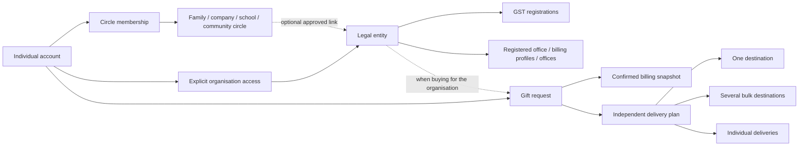

# Business identity, billing and delivery

Decision record · 20 November 2026. **Architecture and UX proposal, not a completed B2B release.** The application currently has individual accounts, real circles, institutional verification claims and B2C order handoff. The legal-entity, company purchasing and multiple-destination records below are not yet live. No SQL, account changes or backfill is included in this proposal.

## The product decision

Everyone signs in as an individual. That person can buy personally or act for an authorised organisation. A circle describes a community and its occasions; a legal entity describes who is buying and who must appear on the invoice. Neither determines where the gifts go.

**B2B/B2C is an order context, not a permanent type of person.** An employee can place a personal order and a company-funded order from the same account. Recipients may be employees, customers, friends, family or event guests. Their relationship does not identify the payer or require an account. A company can place a gift without first creating a circle. A community or alumni circle can also link to a real buying entity when appropriate; category alone never creates one.

## Entity information

| Record             | Fields and meaning                                                                                                                                                                                                                |
| ------------------ | --------------------------------------------------------------------------------------------------------------------------------------------------------------------------------------------------------------------------------- |
| Legal entity       | ID, legal name, optional trading name, country, optional entity type, lifecycle/verification state, version and audit timestamps. Registered office is an explicit address reference. Contact/billing information is not a login. |
| GST registration   | Entity ID, GSTIN, registration state, registration billing address, verification state/evidence reference. Support more than one registration for the same entity. Do not overwrite one GSTIN with another state's registration.  |
| Entity address     | Label, address lines, city, state/code, PIN, country and allowed purposes: registered office, billing or office/delivery. One address may serve several purposes when deliberately selected.                                      |
| Billing profile    | Entity, invoice legal name, selected billing address, GST registration or explicit unregistered status, billing email, optional billing contact/phone. Defaults are suggestions for future orders.                                |
| Entity access      | Account, entity, explicit role, invited/pending/active/revoked state, inviter, approval and audit. It is separate from circle membership.                                                                                         |
| Circle/entity link | An optional, approved relationship between a circle and a legal entity. Several circles can refer to one entity. If a group contains several legal entities, select exactly one buyer per order.                                  |

The registered office, GST registration address, invoice address and delivery address can differ. Reuse is an explicit convenience such as **Use registered address**, not automatic copying. Office addresses can be reused for bulk delivery; employees' home addresses are never compulsory for an office delivery.

No GST registration is required just to start a brief. At commercial confirmation, choose the appropriate registration or explicitly state that the entity is not GST-registered. A supplied GSTIN needs format/checksum validation and a documented name/state check by Operations; format alone is not government verification. A mismatched or unverified supplied registration remains a billing issue to resolve, not silently discarded. Do not invent a GSTIN or substitute the individual's tax details. GST registration does not imply tax exemption, input-tax-credit eligibility or a particular tax rate.

The first implementation is India/INR, consistent with the existing service. Store country explicitly; international billing/shipping is a later extension. PAN, bank details and legal incorporation documents are not default customer fields. If evidence is needed for authority, collect the minimum through a private process, not public image storage.

## Authority and privacy

Company website/domain checks remain lightweight institution checks. They neither prove legal identity nor grant commercial authority. Do not grant authority through a matching email domain, circle admin role, shared Shopify customer or caller-supplied entity ID.

| Actor                                     | Allowed scope                                                                                                                                                                                  |
| ----------------------------------------- | ---------------------------------------------------------------------------------------------------------------------------------------------------------------------------------------------- |
| Circle member/admin without entity access | Circle membership/occasions as currently permitted. No access to business billing or company orders merely through the circle.                                                                 |
| Pending entity claimant                   | Draft their proposed business details and an unsent brief. Cannot publish the business as verified, grant active company purchasing rights or commit a company order.                          |
| Entity owner/admin                        | Manage entity details and explicitly grant/revoke roles; see entity orders. Billing identity changes invalidate the relevant verification until reviewed.                                      |
| Buyer                                     | Create/act on assigned or self-created entity requests; use approved billing profiles. No role management or automatic access to every colleague's orders.                                     |
| Finance                                   | See entity quotes, invoices and payment evidence; participate in financial reconciliation. No automatic authority to change gifts or access recipient home addresses/private profiles.         |
| GYVFT Operations                          | Review claims, billing and delivery readiness and carry out the order handoff. Keep the existing protected operator boundary; shared-secret access is not evidence of named staff attribution. |

For the pilot, Operations reviews the first entity claim and establishes its first active administrator through a documented business contact/authority check. Subsequent invitations are email-bound and grant the named entity role only after acceptance. A person can hold several explicit roles. Sensitive delivery access is limited to the buyer/assigned fulfilment coordinator and authorised Operations, not the whole company circle.

Normal circle invitations continue to create membership, not purchasing rights. Revoking entity access must revoke future company reads/writes even if the person created an old business order. The entity retains the commercial history; the former employee retains their own personal orders. Use explicit reassignment to let the team continue an employee's business request. No deletion or transfer of personal orders is implied.

Names/domains are not deduplication keys. Normalise GSTIN and detect existing claims privately; conflicting claims go to Operations without exposing another organisation's members or billing details. Never auto-merge entities or old orders. A circle institution claim may suggest a new entity draft only through an explicit authorised command, not a migration or page load.

## Order billing is a versioned commitment

A request holds `requested_by_account_id`, `purchase_context` (personal/organisation), optional `buyer_entity_id`, optional circle/occasion context, billing-profile selection and a separate delivery plan. The server obtains the actor from the session, resolves all referenced records within the authorised entity and calculates readiness. Clients do not submit trusted role, verification or ownership flags.

Before the customer approves the commercial commitment, show **Ordered by**, **Buying for**, **Bill to** and **Deliver to** as distinct concepts. Personal is the default; asking for GST details must not add steps to personal gifting.

Capture an immutable version of legal name, selected GSTIN/unregistered declaration, billing address/contact, purchase-order reference if provided, currency and approved quote totals. Bind it to the exact quote and delivery-plan versions. Retain source record IDs for audit, but render the saved snapshot for that historical order. Later edits to an entity or address book must not rewrite an issued order or invoice.

A purchase-order number/reference is optional unless that entity explicitly requires it. There is no new corporate credit/NET-payment policy: retain 50% advance and the remaining 50% before dispatch. Tax amounts and required invoice particulars must be confirmed by Operations/the invoicing system; do not derive tax treatment solely from delivery state or a GSTIN prefix.

Changing buyer/entity, GST registration, billing identity, delivery mode or destination allocation before commitment revalidates billing, tax and delivery cost. Changes to an approved commitment require an explicit revision and any affected quote approval. After the official Shopify order is linked, corrections go through Operations/the official order with a retained audit trail. Production continues to reject customer changes as already agreed; it must not be paused/reopened by a new edit flow.

An employee paying a company order does not turn its bill-to identity into the employee. Record the remitter and verification separately. Do not count a payment screenshot as verified receipt or duplicate a payment when moving it to the official order.

## Delivery is independent of billing and recipients

| Arrangement               | Required information                                                                                  | Not required                                                           |
| ------------------------- | ----------------------------------------------------------------------------------------------------- | ---------------------------------------------------------------------- |
| One destination           | One destination address/contact and the entire gift-set quantity. It can be an office, home or venue. | Individual employee/guest addresses or employee accounts.              |
| Several bulk destinations | Destination/contact and gift-set quantities for each allocation.                                      | A list of every recipient where the allocation only needs bulk counts. |
| Individual deliveries     | One allocation/address/contact per intended delivery. An address may receive several gift sets.       | Recipient signup or circle membership.                                 |

One data structure handles all three: a delivery plan with destination allocations. Each allocation has an ID, label, destination kind, contact, address, number of **gift sets**, optional recipient links and eventual shipment records. Do not count product pieces as gift sets: 100 hampers with three products each are 100 sets, not 300 deliveries. One destination may have several parcels/tracking numbers. Shipping rates are quoted per actual arrangement, not guessed from the number of addresses.

During the enquiry, allow delivery mode **To be confirmed** and incomplete addresses. Do not expand the public seven-step Tell Your Story form or force employee imports. Resolve final locations/quantities privately before final pricing and official order creation; if an address-dependent shipping quote is still pending, show that explicitly rather than presenting a false all-inclusive total.

At confirmation, all delivery addresses must be complete; each allocation quantity is positive; allocation IDs are unique; total allocated gift sets equals the approved number of sets. Never silently duplicate, discard or redistribute quantities when switching modes. Preserve a draft and ask the user to resolve any mismatch. The number of recipients, number of sets and number of destinations are independent values.

For mixed office and home delivery, use the same allocations (for example office ×60 and individual destinations ×40). It must not require two paid orders just because address types differ. Recipient associations are optional for bulk lots. Private recipient preferences do not get copied into shipping manifests or exposed to Finance.

Occasion date and requested delivery date remain separate. Allow a requested/confirmed date per allocation when needed; do not infer occasion dates from shipping targets. Arrival promises require an Operations confirmation. Failed attempts, rescheduling or missing contact information must not be labelled delivered. Delivery exceptions are support/fulfilment events, not permission to change gifts after production.

Use explicit shipment/allocation states and quantity checks. A partial dispatch or one delivered destination does not complete the whole order. The customer sees **60/100 sets dispatched**, destination-level progress and the next action. The full order becomes delivered only when all committed sets are actually delivered. A delivery exception remains an exception; it must not be counted as successful delivery. No cancellation/refund policy or right to change a gift after production is introduced here. Dispatch still requires the agreed full verified payment.

## Customer UX

The existing gift intake stays simple. Personal gifting stays the default. A compact **Buying for myself / An organisation** choice belongs in optional request context, with company details progressively completed before commercial confirmation.

Business details belong in **Account → Billing & organisations** and in a linked institutional circle's Settings. Avoid adding a new top-level navigation item for every entity. A circle admin without entity authority sees **Request business access**, not private billing fields.

1. **Business details:** legal/trading name, registered office and optional office locations. Add GST registrations/billing profiles only when relevant. Read-only summary first; edit specific sections instead of a giant mandatory form.
2. **People & access:** show business roles separately from circle membership. Invite/approve/revoke explicit purchasing or finance access. Label pending claims and verification clearly.
3. **Gift billing & delivery:** retain the chosen gift/quote context. Select buyer and bill-to profile; choose one location, several locations, individual deliveries or confirm later. Show only the matching fields. Bulk delivery starts with the company's saved office options, never with a mandatory employee list.
4. **Review commitment:** compact Ordered by / Bill to / Deliver to summary, quantities, taxes and separately quoted packaging/delivery, 50% now and remaining 50% before dispatch. Unresolved billing/allocation/price checks are actionable, not a vague disabled button.
5. **Operations handoff:** show readiness, assigned operator task and exceptions. Copy correct billing and delivery details into the official system, reconcile its reference and expose truthful customer progress. No automatic Shopify creation is implied by saving an entity.

The interactive `/business-review.html` is a fictional-data prototype of these decisions, separate from the application. Its local review snapshots are not legal invoices, saved accounts, payments or Shopify orders. Its policy checks illustrate the proposed flow; they do not replace server validation.

## Shopify boundary

The current `src/lib/customer/shopify.ts` intentionally accepts B2C projects only, associates the individual's Shopify customer, writes one shipping address and creates a single custom batch line with quantity 1 to preserve the exact approved total. It does **not** yet supply business bill-to identity or a delivery manifest. Removing the B2C guard alone would be incorrect.

Preserve the individual's matching Shopify customer as the ordering contact. A business order must separately retain the approved buyer legal entity, billing address/GST registration and requester reference. Do not mutate the customer's personal default address or rename their personal account to a company name whenever they order for work. Do not require native Shopify Company objects until the merchant plan and intended API are verified; this legal-entity model does not depend on that feature.

[The pinned 2026-10 order creation API](https://shopify.dev/docs/api/admin-graphql/2026-10/mutations/orderCreate) distinguishes `billingAddress` and `shippingAddress`; [MailingAddressInput](https://shopify.dev/docs/api/admin-graphql/2026-10/input-objects/MailingAddressInput) supplies address fields. Map the selected billing snapshot to the former, and the actual sole destination to the latter for one-destination orders. A `company` address string is not a complete GST invoice. Confirm the store's invoice process and required GST particulars before claiming tax-invoice support.

**Multiple destinations need an explicit integration gate.** One Shopify order's shipping address cannot stand in for an entire destination manifest, and a single batch line of quantity 1 cannot express fractional gift-set fulfilments. Keep the user's single-line order policy. Do not replace it silently with per-recipient lines, duplicate paid orders, fabricated addresses or a partially fulfilled fraction of a batch.

For the initial manual handoff, Operations must confirm how the merchant will retain a restricted delivery manifest/reference alongside that one official order and record partial shipment evidence. Shopify remains the official order/payment/invoice record; GYVFT may show clearly sourced destination progress while the manual handoff is reconciled. Do not mark the whole Shopify batch fulfilled after only one allocation ships. If the merchant's tooling cannot represent the required record faithfully, show **Manual fulfilment arrangement required** and resolve it before accepting that delivery plan; do not advertise automated multi-address Shopify fulfilment.

The automated adapter must be separately implemented and tested against the pinned version and actual store permissions. Native B2B plan requirements, invoice/GST output, restricted manifest storage, the one-line fulfilment representation and full-balance receipt reconciliation are explicit acceptance gates. The review prototype intentionally makes no external API call. Do not upload recipient addresses to public Shopify Files or include home addresses in public notes/links.

## Domain APIs and proposed persistence

These are **proposed contracts**, not deployed endpoints. They operate on business objects, independent of which tab renders them. The existing individual B2C commands remain authoritative until the new model is implemented.

| Domain command/resource                                        | Responsibility                                                                                                                          |
| -------------------------------------------------------------- | --------------------------------------------------------------------------------------------------------------------------------------- |
| `POST /api/customer/entities`                                  | Create an idempotent pending entity claim, not active purchasing authority.                                                             |
| `GET/PATCH /api/customer/entities/:id`                         | Read/update authorised entity details with expected version and audit.                                                                  |
| Entity registration, address and billing-profile subresources  | Maintain separately identified GST registrations and address roles; reject foreign-entity references.                                   |
| Entity invitation/acceptance and access commands               | Email-bound acceptance; explicit role changes/revocation; no circle-role escalation.                                                    |
| Circle/entity link command                                     | Link approved context only with both required authorities. A link grants no purchasing role.                                            |
| Request purchase-context command                               | Personal or entity buyer, role check, billing profile/PO reference and expected request version.                                        |
| Request delivery-plan command                                  | Draft allocations, positive quantities, mode compatibility, owned references and optimistic concurrency.                                |
| Request commercial-confirmation command                        | Atomically resolve authority/current versions, validate readiness, capture immutable snapshots and bind exact quote/selection versions. |
| Operations entity review / Shopify handoff / shipment commands | Explicit operator authority, safe audit, idempotent handoff and quantity-aware fulfilment.                                              |

Proposed additive storage: legal entities, entity access/invitations, addresses, GST registrations, billing profiles, approved circle/entity links, versioned commercial snapshots, delivery plans/allocations and shipments. Add nullable context references to the existing request instead of a second competing order database. Foreign keys and server checks must constrain registrations/profiles/addresses to the selected entity. Enforce one selected buyer per commitment; partition locks by entity/request; preserve immutable source versions and operation idempotency keys. All sensitive tables deny direct browser-role access.

No automatic conversion of existing circle claims or old B2B labels. Existing personal gifts retain their ownership/address semantics. When implementation is ready, present the exact additive migration for separate production approval; builds, deployment, startup and page reads never migrate. Backfill, if needed, is another explicit reviewed operation. No deletion is authorised by this plan.

## Implementation sequence and acceptance

| Step | Deliverable                                               | Must pass before release                                                                                                                                                                                                        |
| ---- | --------------------------------------------------------- | ------------------------------------------------------------------------------------------------------------------------------------------------------------------------------------------------------------------------------- |
| E1   | Sign off this domain and the interactive UX review        | Personal/organisation identity, distinct addresses, all three delivery modes and one-line Shopify constraints are understood.                                                                                                   |
| E2   | Entity records, claim review, access and billing profiles | Separate production SQL approval; India/GST validation; pending/accepted/revoked states; same individual across entities; circle members cannot access business billing.                                                        |
| E3   | Request context and delivery plans                        | Personal path remains simple; drafts may be incomplete; exact allocation sum; bulk without employee addresses; mixed destinations; request versions reject stale edits.                                                         |
| E4   | Commercial snapshot and Operations                        | Billing profile edits cannot change history; exact quote binding; new authority check at commit; taxes/charges/payment milestones; production/official-order locks remain enforced.                                             |
| E5   | Shopify handoff and delivery tracking                     | Correct customer plus separate bill-to, verified invoice/GST output, duplicate/uncertain handoff recovery, safe manifest policy and truthful partial/full delivery. Manual handoff is acceptable if these records are verified. |
| E6   | Guided B2B pilot and reporting                            | One office bulk order, one split/mixed order, two entity users plus an outsider; revocation, invoice/address history, notifications, payment verification and reconciliation checks.                                            |

Launch reports must distinguish customer/purchaser, buying entity, optional circle, approved order value, verified spend, pending payment proof, sets and destinations. Do not count the same payment against both personal and company spend totals; a personal view may show “ordered by you for Meridian” without implying personal expenditure. Finance sees only authorised entity figures. Detailed dashboards, spend limits, multi-stage procurement approvals, credit terms, bulk CSV import, automatic government verification and cross-company discovery are later work.

Current verification is inspection of the existing circle/order code and browser testing of the isolated review prototype. This proposal does not establish production entity, GST invoice or multi-address Shopify support.
