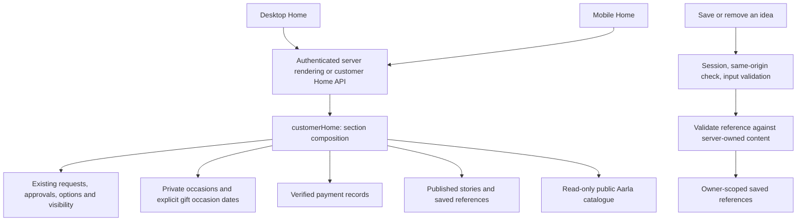

# Customer Home: architecture and API contract

The approved Home design has three carousels: Gifts taking shape, Upcoming occasions, Coming up at Aarla. Desktop also includes the slogan, editorial inspiration, saved ideas and a payment summary. Mobile has a compact layout. These are two presentations of the same customer data; there is no device-specific database or API. The full gift list is a separate destination, rather than a repeated Home worklist.

The approved Home is now connected to these services. Desktop retains the slogan and the lower inspiration/saved/payment area; mobile uses compact cards and ends with Aarla, followed by navigation. The full request list, occasion manager, saved ideas and verified-payment history remain reachable through navigation/profile. The individual gift detail redesign remains a mock for design review. See [application typography and spacing standards](APPLICATION-UI-STANDARDS.md).

## Boundaries

- Customer identity comes from the existing GYVFT session cookie. Neither account IDs nor email addresses are accepted as request parameters. No new authentication provider or login is introduced.
- Route handlers are thin transport adapters. `customerHome` can also be called directly after `requireCustomerAccount()` in a Server Component; do not make an HTTP request from that component to its own API.
- `home-model.ts` defines shared card, pagination and action contracts. `home-data.ts` reads operational data. `home-content.ts` resolves published editorial stories. `saved-ideas.ts` manages private saved references. `api.ts` owns JSON, authentication and error boundaries.
- Customer responses are `private, no-store` and vary by Cookie. Only the existing public Aarla feed has a shared 15-minute Next fetch cache. No order, Shopify customer, payment request or email is created by reading Home or saving an idea.

## Reads

`GET /api/customer/home`

Optional query parameters (unknown parameters are rejected):

| Parameter | Values / default |
| --- | --- |
| `section` | `all` (default), `gifts`, `occasions`, `aarla`, `saved`, `payments`, `inspiration` |
| `offset` | Integer 0–10000, default 0 |
| `limit` | Integer 1–20, default 6 |

An initial request returns all sections. Advancing a carousel requests only that section, for example `/api/customer/home?section=gifts&offset=6&limit=6`. Desktop may load all sections; mobile can request the three relevant sections separately or ignore the additional initial data. No user-agent detection is needed.

The JSON envelope is `{ok:true,data:{version:1,generatedAt,today,timeZone,account,sections}}`. Dates use Asia/Kolkata. `account.displayName` is currently null because the account model does not collect a display name. The UI must use a generic greeting rather than inventing a person's name from their email.

Each requested section is either:

- `{status:"ready",data:...}` — a real result, including genuine empty arrays and zero totals;
- `{status:"setup_required",data:null}` — a required table/column is missing;
- `{status:"unavailable",data:null}` — an unexpected read failure or unavailable catalogue.

A section failure does not erase other sections. These structured section results use HTTP 200; the UI must inspect `status`. Authentication failures return 401, invalid input 400, rate limits 429. Unexpected transport/auth-database failures return a safe 503 envelope. SQL messages, connection details and provider payloads are never returned.

Collections carry `{items,total,offset,limit,nextOffset}`. Heading counts use `total`, not `items.length`. `nextOffset:null` is the end. The client can go back to offset zero for a wraparound carousel. Counts reflect this response's source data; offset pagination is deterministic for unchanged data, but changes between requests can move cards, so refresh from zero after a mutation. No automatic carousel rotation is implied.

### Gifts taking shape

Active requests have `stage<10`, including enquiries and converted projects. Delivered/completed gifts stay in history. Real requests precede labelled samples. Within each group: latest pending approval, payment due, options ready, then waiting gifts; requested delivery date and stable creation/ID ordering break ties.

Cards expose title, stage and next-action text, separate occasion/requested-delivery dates, the original quantity **range**, visible curated option count, a protected image URL and one action. A range is never relabelled as an exact recipient count. No brief narrative, contact data, image bytes, integration ID or payment evidence is serialized.

Actions derive from operational records:

| State | Action |
| --- | --- |
| Latest pending design/proposal | Review design / Review quote |
| Converted project awaiting its advance | Pay advance, until the rounded-up 50% threshold is met |
| Packing with unpaid balance | Pay balance |
| Pending payment proof | Payment under review; never claim payment succeeded or ask to pay again |
| Visible options on an enquiry without a quote request | Review options |
| Other active states | View gift |
| Sample | View sample; no actionable payment/approval CTA |

Published, visible curated options contribute to the option count; customer experiments are separate drafts. Latest proof artwork is preferred for the image, then a published visible curated hamper. Superseded proofs and hidden options do not supply the image. Null means the UI should use its event/occasion fallback. Assets retain the existing authenticated ownership gate.

### Upcoming occasions

Combines the customer's private calendar with explicit occasion dates on their active real gifts. Delivery dates and the original enquiry target date do not become occasions. Project-linked cards open that gift; private calendar cards offer Start/Plan a gift. There is no automatic order creation or prefilled public-form rewrite.

Annual recurrence is computed before sorting/paging. Leap-day anniversaries display on February 28 in non-leap years without changing the stored birthday. Past one-off dates are omitted. `source` distinguishes `calendar` and `gift`; `daysAway` is based on Indian calendar days. Calendar photos use protected URLs; other cards return a null image for a UI fallback. Circle names, recipient identities and photographs are not invented. Existing `addOccasion`, `removeOccasion` and `saveRequestDates` Server Actions remain the mutation entrypoints, with session-derived ownership and existing image validation. The original seven-step enquiry form is unchanged.

### Coming up at Aarla

Read-only product cards from the existing public catalogue feed, available products only, newest first. Products carry current feed pricing, any compare-at price, image and a tracked Aarla product link. Prices are INR paise. The API includes a reminder that checkout prices and availability are confirmed at Aarla; compare-at prices support an offer display without invented discounts.

The feed is bounded to three pages of 100 products. `total` is the number of eligible products in that fetched window, not the entire Shopify store. It is intentionally not shown as a store-wide count. Catalogue outages return `unavailable`; they never empty the customer's gifts or saved ideas. If only the saved-product migration is pending, discovery still loads with `savingAvailable:false` and its Save control is omitted. No Shopify Admin API credentials are needed for this read path.

### Inspiration and saved ideas

Editorial inspiration resolves to a published, non-placeholder story in the existing content registry. It is a real story, not a new CMS or an automatic product recommendation. The initial featured-story selection is defined in `home-content.ts`.

Saved stories retain their existing table; unpublished stories cease to appear in reads. Saved Aarla products use the new `gyvft_customer_saved_products` table with an account/product primary key and a small server-derived title/image/link snapshot. Those snapshots survive a catalogue outage or product retirement, but do not claim current stock or price: availability is `unknown` until checked at Aarla. Saving never changes the original story or product. No external comments or collaboration permissions are introduced by this feature.

### Payments & receipts

- `paidThisFinancialYearPaise`: sum of **verified**, dated payment records between April 1 and the following April 1 in Asia/Kolkata. Pending/rejected screenshots, quotes, budget ranges, sample data and other accounts are excluded. An undated legacy record cannot be assigned to a financial year.
- `completedGifts`: all-time delivered/completed real converted gifts, explicitly labelled `completedGiftsPeriod:"all_time"`.
- `outstandingPaise`: unpaid total across active real projects. This includes future balances and is not the same as an immediate payment demand.
- `dueGiftCount`: gifts currently awaiting advance or packing-stage balance, excluding a gift with pending verification. `pendingVerificationGiftCount` is separate. The UI must not say “No payment due” when verification is pending without explaining that state.
- `receipts`: paginated verified-payment records across all time, with amount, nullable verification timestamp and the owning gift link. These are **payment acknowledgements**, not generated GST invoices or downloadable files. A formal invoice service is separate work.

## Saved-idea writes

`PUT /api/customer/saved-ideas` saves; `DELETE /api/customer/saved-ideas` removes.

Use JSON `{kind:"story",id:"published-story-slug"}` or `{kind:"product",id:"123456789"}`. The body is capped at 2 KB. Extra keys are rejected: clients cannot set the owner, title, URL, image or price. Writes require the current app's exact Origin and a valid session. They invalidate `/account` after success and return `{ok:true,data:{kind,id,saved}}`.

Operations are explicit and idempotent, rather than toggle operations that reverse themselves on retry. Saving a product validates its reference against the server-fetched catalogue. Catalogue failure returns 503 rather than saving untrusted data. Removing an existing reference works even if the catalogue or story is no longer available. Every mutation binds the session account in SQL. An unknown reference on removal is a successful no-op and reveals nothing about another account's saved data.

## Setup and rollout

`20261117000001_customer_home.sql` is included in the customer-only `/setup` manifest. It adds the saved-product table, enables RLS/revokes browser roles and adds supporting indexes on existing customer tables. It does not modify Aarla OS or the legacy Studio CRM, truncate enquiries, migrate authentication or seed fictional money.

After deployment, run pending customer migrations once through `/setup`. The new Home is the default `/account` view; existing gift options and enquiry details retain their routes. A missing new saved-product table yields a setup-required saved section rather than a false “you have no saved ideas” state.

## Verification

Unit coverage checks action thresholds, pagination totals, year boundaries, same-origin writes, unauthenticated reads, reference-only inputs, safe errors and independent section failures. The opt-in disposable database suite exercises the actual customer migration runner and read queries, cross-account isolation, hidden/superseded content, repeat setup, annual dates, fiscal boundaries, pending/rejected exclusions, saved-reference idempotency, outage removal and denied `anon` access.

Run `HOME_TEST_DATABASE_URL=<disposable-local-postgres-url> npx vitest run tests/unit/customer-home-db.test.ts`. The suite refuses remote hosts. It runs customer migrations and deletes only its own UUID fixtures; use an isolated test database, never production. A local PGlite socket run verifies SQL behavior but does not establish production load or concurrency performance.
