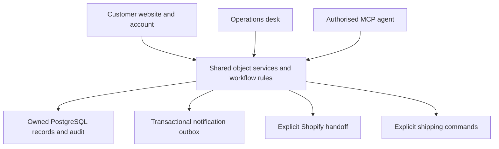

# GYVFT product and engineering decision book

GYVFT brings the people, occasions, choices and operational work behind a thoughtful gift into one place. The central decision was to make gifting a continuing relationship rather than a sequence of disconnected purchases. Aarla supplies curation and execution; GYVFT retains the context, helps the customer decide, and carries the agreed commitment into Operations and the official order record.

Prepared for GYVFT’s founder, product and design collaborators, Operations team, engineers and future agents on **25 November 2026, India time**. The record covers the decisions visible in the supplied build conversation and repository through the agent Operations release, PR74. It includes the reasons, trade-offs, resulting behaviour, corrections and intended impact—not just a feature inventory.

Three distinctions govern the account throughout: **a design decision is different from implemented code; implemented code is different from activated production capability; and a passing fixture is different from a real customer or provider outcome.** Product and operational benefits described as expected are hypotheses to measure, not conversion results already achieved.

The owner’s most consequential instructions were consistent: build for the object model; preserve the human feeling of gifting; make action clear; keep Shopify authoritative for official orders; permit no gift or artwork changes after production starts; and obtain explicit approval before production migrations or data deletion. The application became stronger when these instructions were treated as system rules rather than screen copy.

# Reading map

Chapters 01 to 10 explain the product, research, architecture and visual direction. Chapters 11 to 21 follow customer gifting, Circles, business context, delivery and Operations. Chapters 22 to 31 explain official orders, benefits, authentication, onboarding, agents, analytics and infrastructure. Chapters 32 to 40 cover evidence, accessibility, reliability, testing, future work, impact and the 120-decision register. The screen inventory, glossary and source guide provide reference detail.

# 01 The product we chose to build

## Gifting begins before a product search

The starting problem was larger than finding a hamper. A giver often knows the relationship, the occasion or the feeling they want to express, but does not yet know the right object, artwork, quantity, packaging or delivery arrangement. A product catalogue asks that person to solve the curation problem before the business can help.

GYVFT instead starts with a story: who the gift is for, what matters about them, what the occasion means and the practical constraints. This made the brief, the recipient context and the occasion first-class product concepts. Product discovery can support that process, but a Shopify SKU is not required to begin it.

The impact is a more useful entry point for uncertain customers. A person can say “I want to thank this team” or “We are hosting a family function” without pretending to know the final gift. For Aarla, a structured account of that intention is a better starting point than a loose WhatsApp message followed by repeated questions. Neither benefit proves faster conversion by itself; both define what the experience should make possible.

## Personal gifting includes gifts for gatherings

The owner corrected copy that framed the product too narrowly around another person’s birthday or “their days.” GYVFT must also accommodate the user’s own celebrations, family functions, return gifts, reunions and appreciation for a group. The underlying idea is making important days special, rather than restricting the service to one recipient or a calendar reminder.

This matters to the model as well as the headline. One gift request may serve one person, a family celebration or a hundred recipients. Recipient count, gift-set quantity, number of addresses and payer identity must remain independent. Making them equivalent would make simple return-gift and company scenarios awkward from the start.

## An account should retain value between orders

The account holds people notes, preferences, occasions, circles, saved references, past choices and gifts in progress. An account is therefore useful before the first paid order and after delivery. “Start with one person; the gift can come later” expresses this low-commitment entry well.

The recurring Aarla shopping benefit adds another reason to return, but it is not the whole product. Rewards from Aarla Play or Kelvi could eventually connect additional touchpoints. Those are extensions of the relationship, not a reason to replace the gifting journey with a generic points dashboard.

**Decision basis:** [customer Home architecture](https://github.com/vanipriya-j/gyvft/blob/9889aba18b5355b66f630b9df72fe08f56442e30/docs/CUSTOMER-HOME-ARCHITECTURE.md), [customer website](https://github.com/vanipriya-j/gyvft/blob/9889aba18b5355b66f630b9df72fe08f56442e30/docs/CUSTOMER-WEBSITE.md), and the owner’s product corrections in the build conversation.

# 02 Product principles that survived the revisions

| Principle | What it requires in practice | What it protects |
| --- | --- | --- |
| Start with the customer’s story | Capture intention and constraints before requiring a finished configuration | People who need curation rather than a catalogue |
| Build for objects | Reuse account, request, selection, approval, receipt and shipment services across interfaces | Consistency when screens or channels change |
| Separate preparation from commitment | Keep private drafts, published versions, approval and payment as distinct acts | Freedom to explore without accidental promises |
| Make the next action understandable | Explain who acts next, what is due and what changes after an action | Customer confidence and operator throughput |
| Use evidence for irreversible progress | Require exact approvals, verified funds and real shipment records | Commercial and operational trust |
| Preserve individual privacy | Circle membership and shared occasions do not expose private gifts | Safe social context without accidental surveillance |
| Prefer a working manual path where appropriate | Let Operations record verified reality while integrations mature | Pilot continuity and truthful records |
| Obtain explicit schema approval | Review exact production SQL separately from code deployment | Customer data and owner control |
| Be honest about capability | Identify mockups, provider acceptance and manual actions accurately | Credibility during onboarding |
| Keep the brand energetic | Use a warm canvas, strong type and obvious actions | Approachability without visual inertia |

These principles resolved many apparently small disagreements. For example, a loader belongs outside the toolbar’s layout because the next action should stay where the operator expects it. A screenshot cannot increase verified revenue because evidence of an attempted payment is different from receipt of funds. A circle label cannot substitute for an actual membership record because social context needs enforceable relationships.

The principles also set limits on speed. A manual fulfilment entry can be acceptable; silently weakening an order gate cannot. A quick quote parser can save typing; inventing the missing price cannot. An agent can act on an explicit instruction; customer text inside a brief cannot grant it permission to publish or record money.

# 03 How the build developed

The product did not appear in one complete pass. It moved from a customer portal and brief flow into a gifting workspace, a reviewable prototype, an implemented customer and Operations journey, then deeper account, integration and agent capabilities.

| Development phase | Main decision or correction | Durable result |
| --- | --- | --- |
| Customer portal and pilot | Give requests, approvals, messages, receipts and delivery a customer-owned home | A real service workflow beyond a public enquiry form |
| Home and gift workspace | Show relevant work and dates without duplicating the complete order list | Different views over shared customer objects |
| Interactive review | Make the complete customer and Operations flow navigable before implementation | A 52-preview reference and a repeatable review script |
| Commitment review | Clarify curated choice priority and 50% now versus balance before dispatch | Better understanding at the point of financial commitment |
| Approved application release | Carry prototype decisions into real ownership, approval, payment and production rules | Server-enforced workflows, not merely convincing screens |
| Shared theme and Operations frame | Apply the palette globally and stabilise navigation and loading | Coherent branding and less spatial movement |
| Authentication incident and migration correction | Separate render success, account lookup, email acceptance and data history | Safer diagnostics and explicit manual production setup |
| Real Circles | Replace community labels with memberships, recipients, invitations and consent | A genuine relationship model |
| B2B planning | Separate person, circle, buying entity, billing and destination | A foundation for company purchasing without conflating identities |
| Parcel shipping | Integrate Delhivery while retaining manual courier and pickup paths | Quantity-aware partial delivery without false fulfilment |
| Aarla shopping saving | Reuse or issue a customer-only single-use code before redirecting | A recurring benefit across the GYVFT and Aarla boundary |
| Public website and stories | Sell the reason to create an account and demonstrate curation | A clearer acquisition path with factual portfolio evidence |
| Analytics | Separate visits from operational conversion and three-day follow-up | Better diagnosis of where interest becomes a gifting commitment |
| Draft MCP and galleries | Let a conversational agent save priced option drafts and images | Less manual copying between curation and Operations |
| Intake and expanded MCP | Support Ops-created customers, evidenced approvals, payment requests and guarded actions | Human and agent interfaces over the same operational rules |

The repository records these phases in PRs and continuation documents. Dates and test totals in older documents describe those releases; they are not a single cumulative certification. The meaningful historical thread is the decision that persisted or was corrected, rather than the number of screens or commits.

**Decision basis:** [repository history](https://github.com/vanipriya-j/gyvft/commits/main), [continuation guide](https://github.com/vanipriya-j/gyvft/blob/9889aba18b5355b66f630b9df72fe08f56442e30/docs/CODEX.md), and [approved gifting release](https://github.com/vanipriya-j/gyvft/blob/9889aba18b5355b66f630b9df72fe08f56442e30/docs/APPROVED-GIFTING-RELEASE.md).

# 04 Research and frameworks that informed the work

## The documented design references

The typography and spacing work has a concrete research record. It compared established application design systems and accessibility guidance before recording GYVFT’s own role-based standards. Those references supplied a vocabulary and useful ranges; the resulting values were product choices, not universal rules copied from a benchmark.

| Documented reference | Finding used | GYVFT decision |
| --- | --- | --- |
| [Atlassian typography](https://atlassian.design/foundations/typography) and [application guidance](https://atlassian.design/foundations/typography/applying-typography) | Compact app text can use 14px/20px; extended reading benefits from 16px; hierarchy and semantics matter | Use compact operational text while preserving larger messages and editable mobile text |
| [IBM Carbon type sets](https://www.carbondesignsystem.com/building-blocks/foundations/typography/type-sets) | Productive typography and expressive typography serve different jobs | Keep functional task screens restrained and reserve expressive serif treatment for meaningful headings |
| [Atlassian spacing](https://atlassian.design/foundations/spacing/) | A small token scale and proximity communicate relationships | Use 4, 8, 12, 16, 24 and 32px relationships instead of accumulating arbitrary gaps |
| [Material typography roles](https://m3.material.io/styles/typography/applying-type) | Display, headline, title, body and label have separate purposes | Stop treating every piece of app copy like a marketing headline |
| [WCAG target size](https://www.w3.org/WAI/WCAG22/Understanding/target-size-minimum.html) | AA minimum and enhanced target criteria differ | Adopt a product aim of 44 by 44px effective touch targets without claiming that every WCAG AA control must be 44px |
| [WCAG text spacing](https://www.w3.org/WAI/WCAG22/Understanding/text-spacing.html) | Content must survive user spacing overrides | Permit reflow and expansion rather than fixing heights that clip enlarged text |

These references did not determine the red/olive palette, the exact dashboard composition or the service rules. Those came from the owner’s brand direction, task requirements and reviews. They also do not establish WCAG conformance for the entire site. Specific keyboard, dialog, reflow and control checks are evidence for those behaviours only.

## Architectural principles used in the implementation

The owner’s instruction to build APIs for the object model led to shared domain functions and thin transport layers. This resembles domain-driven and ports-and-adapters thinking: a request and its approval rules should survive changes to tabs, mobile composition or a conversational interface. The record supports the implementation pattern; it does not establish that the team ran a formal domain-driven-design programme.

Versioned commitments, durable idempotency keys, transactional outboxes, least-privilege OAuth scopes and explicit state transitions are engineering patterns visible in the implementation. They solve specific failure modes: stale approvals, duplicate external work, lost notifications and overly broad agent access.

Progressive disclosure, recognition over recall, visibility of system status, proximity and error prevention are useful explanations of the UX. Where this book uses those names, it is interpreting concrete choices—such as optional detail sections, curated recommendations and visible pending states—not claiming a separate formal research study was conducted under each label.

## The benchmark was task comprehension

The strongest benchmark became a first-time giver’s ability to select a gift, explain exactly what they approved, state what they owe now and later, and find delivery status. For Operations, it was the ability to choose the next task and explain the customer-visible result. Attractive screenshots, a large screen count and an 8/10 mockup review were useful signals, but they could not replace those tests.

The supplied review reported 13 of 16 original findings resolved at that point. Its later recommendations focused on payment language and curated-choice emphasis. That review outcome belongs to the prototype iteration; it is not a claim that the real application or every later integration received independent sign-off.

**Decision basis:** [application UI standards](https://github.com/vanipriya-j/gyvft/blob/9889aba18b5355b66f630b9df72fe08f56442e30/docs/APPLICATION-UI-STANDARDS.md) and [first-time review protocol](https://github.com/vanipriya-j/gyvft/blob/9889aba18b5355b66f630b9df72fe08f56442e30/docs/GYVFT-DESIGN-REVIEW-TEST.md).

# 05 The object model before the screens

## The central objects

The customer request aggregate is anchored in `customer_projects` and its related records. An enquiry and a confirmed project are stages of a business relationship represented through this model, rather than unrelated databases for each screen.

| Object | Question it answers | Important boundary |
| --- | --- | --- |
| Account and session | Who is acting? | Authentication does not itself grant Operations or company purchasing authority |
| Profile and private people notes | What do we know about someone? | Self-shared information and the giver’s private notes have different audiences |
| Occasion | What date or moment matters? | A recurring occasion is not an automatically created order |
| Circle and membership | Which community is this person part of? | Membership does not expose private gifts or establish bill-to identity |
| Gift request and brief revisions | What does the customer want? | Unsubmitted drafts remain private |
| Curated gift option | What does Aarla recommend? | A private draft is not a published offer or an approved quote |
| Customer experiment and selection | What direction did the customer choose? | A selected configuration is a snapshot, not a live editable retail basket |
| Quote or artwork version | What exact commitment needs approval? | A newer version cannot inherit an older approval |
| Payment submission and verified receipt | What was reported, and what funds were confirmed? | A screenshot never counts as verified money on its own |
| Shipment or collection batch | Which physical sets went where? | Partial delivery must not become whole-order completion |
| Feedback and individual photo permissions | What can be retained and what may be featured? | Consent is per item and separate from a staff feature flag |
| Agent command and evidence | What did an authorised agent ask to do, and what happened? | A retry must not become a new business action |

The distinction between objects prevents a common implementation mistake: storing a convenient field on the page currently needing it, then discovering that another page or agent interprets it differently. For example, a payment total is not a dashboard-specific number. It comes from the same verified records used by customer payment status and operational conversion reporting.

## Shared rules across interfaces

Customer server actions, Operations APIs and MCP adapters call shared services. The Home composer can call server-side functions directly after authentication instead of making an HTTP request to its own API. Desktop and mobile do not have separate customer stores. The same principle later made the MCP expansion possible without inventing a second approval workflow.

A useful architecture sketch is:

The model is not a claim of a universal event-sourced system. Ordinary relational tables hold current records, while revisions, selections, approval versions, commands and audit events preserve the history needed for each workflow. It is deliberately narrower and easier to operate than a wholesale event-sourcing platform.

**Decision basis:** [customer Home architecture](https://github.com/vanipriya-j/gyvft/blob/9889aba18b5355b66f630b9df72fe08f56442e30/docs/CUSTOMER-HOME-ARCHITECTURE.md), [gift workspace](https://github.com/vanipriya-j/gyvft/blob/9889aba18b5355b66f630b9df72fe08f56442e30/docs/GIFT-WORKSPACE.md), and [approved release object boundaries](https://github.com/vanipriya-j/gyvft/blob/9889aba18b5355b66f630b9df72fe08f56442e30/docs/APPROVED-GIFTING-RELEASE.md).

# 06 Why this technical stack

The implementation uses **Next.js 16 App Router, React 19 and TypeScript**, with PostgreSQL accessed through the `postgres` client. **Zod** validates command and transport inputs. **Tailwind and semantic CSS tokens** support the visual system; **Radix** supplies accessible interaction primitives; **Lucide** supplies icons; **Framer Motion** supports selected motion. **Sharp** handles bounded image previews. **Resend** transports transactional email. Shopify’s Admin GraphQL integration and Delhivery’s API are explicit external adapters. **Vitest, Testing Library and Playwright/Chromium** provide automated and browser checks.

The book records the reasons supported by the implementation, rather than inventing a comparison exercise against every competing stack. The repository does not establish that Django, Rails, Laravel, Vue, Firebase or every hosting provider was formally evaluated and rejected.

## One application with several roles

Next’s server-rendered pages, server actions and route handlers let the public site, account and Operations desk coexist in one codebase. That reduces duplication for a small team and makes shared domain functions practical. The trade-off is discipline: framework caching, streaming, server/client boundaries and file tracing can affect privacy, perceived performance and deployment size.

Because this was a newer Next version, the repository explicitly required reading the bundled framework documentation before changes. This is a process decision with practical consequences: relying on an older mental model can break route parameters, asynchronous request APIs or caching assumptions. The project also retains a middleware deprecation warning; a successful build is not a reason to ignore framework migration work indefinitely.

## Relational records for relationships and commitments

Accounts, circles, selections, approvals, receipts and shipment allocations are naturally related records. PostgreSQL provides constraints, transactions, unique keys and row locks to enforce those relationships. SQL remains server-owned; neither a browser form nor an MCP request can submit arbitrary SQL.

The connection pool is bounded and reused within a server instance. Commands that need locks own their transactions. The new MCP wrapper deliberately does not hold an outer pool connection while a legacy service starts an inner transaction, avoiding an unnecessary connection-exhaustion or deadlock risk.

## Existing fonts rather than a moving brand

The application uses **Inter** for body text and **PT Serif** for display headings through Next’s font integration. The owner noticed fonts changing during visual revisions. The resulting instruction was to preserve the brand fonts and correct hierarchy, density and layout instead of introducing a new typeface as a shortcut to a redesign.

## A modular monolith rather than distributed services

The current architecture is a single deployable application with separable services and integrations. There is no evidence that this scale required independent microservices, a message broker or a separate AI orchestration backend. Keeping the system together makes feature development and local verification simpler. The cost is that import boundaries, function bundles, database pooling and operational responsibilities must remain explicit.

# 07 The public website became an account acquisition experience

The owner asked whether the site explained what GYVFT does and why someone should log in. That changed the homepage brief from “describe a gifting service” to “make the account’s ongoing value understandable and make signup easy.”

The website therefore connects three ideas: remember the people and moments that matter, let Aarla help turn that context into a gift, and keep the process together in GYVFT. The account CTA enters the actual registration path at `/account/login?mode=signup`; it does not end in a decorative waitlist or a disconnected marketing form.

## The hero must say something a visitor can understand immediately

The owner challenged “Let’s gift like it” because “it” had no clear referent. That was a copy comprehension failure, not a preference for a different adjective. Subsequent language made the people, the important day and the gift explicit. Later, the owner widened the framing again to include their own functions and return gifts.

This illustrates an important rule: emotional copy still needs a clear subject and action. Shorter wording is not automatically clearer. An evocative headline must not force the visitor to solve a pronoun puzzle before learning what the service does.

## The path through the page

Gift stories and team-gifting navigation were corrected to point to the relevant homepage sections rather than unexpectedly sending people to older pages. Detailed case-study cards still lead to individual stories. Anchors account for the sticky header so a section heading is not hidden beneath navigation.

FAQs received a visible top navigation link because their value disappears if visitors must already know to scroll to the bottom. The Aarla benefit also received a distinct entry and a contrasting olive section. The owner clarified that “pop up” meant stand out metaphorically; a literal modal would have solved the wrong problem. We retained visual emphasis and navigation, not an unsolicited interruption.

## Video is chosen rather than imposed

The owner supplied a problem film and a solution film, then replaced the solution with a more visual, approximately 59-second version. The site preserves that distinction and uses posters, named dialogs, native controls and readable alternatives. Video elements mount only after the visitor chooses to watch, and closing the dialog stops playback by unmounting it.

This avoids spending mobile bandwidth before the visitor understands the page. It also preserves user control. The supplied films remain evidence of messaging, not evidence that every capability mentioned inside them—such as reservations—has been implemented in the backend.

**Decision basis:** [customer website decisions and media provenance](https://github.com/vanipriya-j/gyvft/blob/9889aba18b5355b66f630b9df72fe08f56442e30/docs/CUSTOMER-WEBSITE.md), [homepage implementation](https://github.com/vanipriya-j/gyvft/blob/9889aba18b5355b66f630b9df72fe08f56442e30/src/components/public/customer-homepage.tsx).

# 08 The mobile newspaper problem

The owner’s screenshot of a narrow viewport exposed a real weakness: the desktop story had simply become a long column of paragraphs. The same words were present, but the experience felt crowded and editorially flat. Responsive CSS had made the layout fit; it had not made it work.

The approved response was to reduce above-the-fold copy, clarify the first action and bring image and text together. The owner explicitly asked for a mockup before production changes. That preserved a review point for an important marketing surface rather than treating mobile compression as a purely technical change.

Combining hero image and text answered the owner’s observation that the image below the copy felt disconnected. It made the opening feel like a single invitation. Preserving the established fonts avoided solving density by changing the brand. The broader occasion language prevented a more attractive mobile hero from accidentally narrowing the product’s purpose.

Mobile Home follows the same principle. It uses compact image/text cards, a contextual new-gift action, occasions and Aarla discovery. It does not inherit desktop slogan space, large image sizes and every lower-page panel. Complete history and other functions remain reachable through navigation.

The trade-off is intentional: desktop and mobile can present different amounts of information without becoming different products or different APIs. The next action, relationship context and factual state remain the same. This is a better definition of consistency than showing every paragraph at every screen width.

# 09 Visual identity with energy

The owner wanted a premium service without the sleepy effect of brown text on cream. They explicitly rejected replacing the cream background with blue. The accepted direction kept the warmth, strengthened the text and introduced clearer action through red and olive.

| Token | Current value | Intended role |
| --- | --- | --- |
| Cream background | `#f9f6ef` | Warm shared canvas |
| Paper | `#fffdf8` | Content surfaces |
| Near-black | `#191b17` | Clear reading and hierarchy |
| Red action | `#b8232b` | Primary action and selected emphasis |
| Olive | `#62683d` | Secondary emphasis and brand continuity |

The palette belongs at the root of the application. The owner caught that a changed dashboard did not mean the homepage or other screens had changed. A theme is therefore a shared system of semantic tokens consumed by public pages, account screens, dialogs and Operations. It is not a collection of hand-edited brown buttons.

Colour is accompanied by labels and state text. An olive badge cannot be the only explanation of “awaiting verification,” and red cannot substitute for an understandable error. Near-black reading text increases practical contrast and gives the action colours room to stand out.

The intended impact is confidence and momentum: a user should see what to do next without the service feeling cheap or loud. The owner located premium quality in service and product execution, rather than in low-contrast calmness or excessive whitespace. This was a product-positioning decision expressed through the interface.

# 10 Typography density and spacing

The typography system assigns jobs to sizes. Page titles use a regular brand serif, nominally 28/36px on desktop and 24/32px on mobile. Section and gift titles use 20/24px. Normal UI text and button labels use 14/20px; messages, extended reading and mobile editable text use 16/24px. Secondary dates and captions may use 12/16px, without making essential instructions tiny.

The six-step spacing scale is 4, 8, 12, 16, 24 and 32px. Closely related icon/text pairs use the smaller steps; distinct sections use larger ones. Desktop card padding starts around 16px and mobile around 12–16px. These are starting relationships, not a requirement to pad every card identically regardless of content.

The owner repeatedly reported unexplained gaps. The correction was to stop stacking parent padding, child margins, fixed heights and empty grid tracks without considering their combined effect. Peer cards can align without stretching every card’s interior to fill a box. Content-driven height is preferable when text, long titles or accessibility settings need more space.

The same discipline applies to numbers. Tabular numerals help totals and quantities remain readable as they change. Sentence case keeps task screens approachable. Widely tracked uppercase instructions, many nearly identical heading styles and 10px essential labels were avoided because they add effort without improving the task.

**Decision basis:** [application typography and spacing standards](https://github.com/vanipriya-j/gyvft/blob/9889aba18b5355b66f630b9df72fe08f56442e30/docs/APPLICATION-UI-STANDARDS.md).

# 11 Home is an overview rather than the entire application

Customer Home settled around three independently useful collections: **Gifts taking shape**, **Upcoming occasions** and **Coming up at Aarla**. Desktop can also show inspiration, saved references and a payment summary. The complete gift history has its own destination. This prevents Home from becoming both a dashboard and a duplicate order worklist.

The three sections share a data contract but fail independently. Owned gift data should still appear if the public Aarla catalogue is slow. A missing section reports unavailable or setup required rather than erasing the rest of the screen or pretending the collection is empty. Only the public product feed has a shared cache; customer information remains session-owned and private.

Counts use the actual collection total rather than the number currently loaded into a carousel. Pagination and centred previous/next controls make movement deliberate. Autoplay, simultaneous visible scrollbars and duplicate request lists were avoided. With fewer than two items, unnecessary carousel controls disappear.

## Alignment without manufactured whitespace

Desktop carousels share header, card and annotation tracks using CSS subgrid. An explanatory sample notice sits beneath the shared card track so it cannot shorten just one peer card. Cards grow with content instead of adopting a large fixed minimum height. This responds directly to the owner’s concern about gaps and uneven composition.

Missing customer previews can use approved library imagery, but generic inspiration must not masquerade as the actual prepared gift. Real curation/customer images take priority. An actual image that fails is labelled unavailable. Portrait crops and focal positions differ where needed on mobile, while originals remain unchanged.

## Empty states are a useful first action

An empty occasion area asks whose special day is coming up and opens the actual occasion form. It does not manufacture urgency or promise reminders that are not implemented. Empty Operations data similarly describes what real requests will bring rather than inventing activity for visual fullness.

This approach reduces first-use embarrassment: a new account is allowed to be new. Fictional data can demonstrate a mature flow in review and demo accounts, but it does not belong in real operational totals.

# 12 Briefs profiles and occasions retain the human context

The seven-step gifting brief was preserved as the main structured entry rather than repeatedly replaced by new forms for every feature. A customer can start privately, save progress and submit later. Submission retains the same gift ID, giving the request a continuous history rather than creating a second record that loses its earlier context.

Profiles, people and occasions are optional. A person who wants one gift should not have to establish a social network, fill a personality questionnaire or create an organisation before continuing. The richer model supports repeat use without becoming an onboarding tax.

## Likes dislikes and self description

GYVFT stores interests, avoidances and description in the customer profile and private people notes. An invited person can provide their own information subject to sharing choices. The giver’s notes and the person’s shared profile are distinct sources; inviting someone does not silently publish what the giver wrote about them.

The application also has **correctable choice-pattern suggestions**. The tastes page presents repeated selections as patterns and says explicitly that selecting an item for gifts does not establish the user’s personal taste. The user can add a suggestion to interests or dismiss it. This is useful assistance with human confirmation, not a claim of a trained AI preference engine.

That distinction matters. Buying journals for employees does not mean the buyer loves journals. Repeated gift choices can contain information, but the interpretation belongs with the person. The model therefore preserves the difference between observed behaviour, a suggested interpretation and confirmed profile information.

## Occasions connect history to a new gift

An occasion can show recurring context and prior gifts, then start the next gift with that context. This closes the loop between calendar memory and curation. A new annual occurrence does not automatically reorder last year’s choice: quantity, recipients, budget, timing and the desired feeling may have changed.

Dates also have different meanings. Occasion date, requested delivery date and confirmed fulfilment progress must not be collapsed into one “date.” The customer may need gifts before the celebration. Operations must confirm feasibility; the interface must not convert a requested date into a delivery promise by its wording.

**Decision basis:** [approved customer routes](https://github.com/vanipriya-j/gyvft/blob/9889aba18b5355b66f630b9df72fe08f56442e30/docs/APPROVED-GIFTING-RELEASE.md), [profile and taste implementation](https://github.com/vanipriya-j/gyvft/blob/9889aba18b5355b66f630b9df72fe08f56442e30/src/lib/customer/journeys.ts), and [tastes review screen](https://github.com/vanipriya-j/gyvft/blob/9889aba18b5355b66f630b9df72fe08f56442e30/src/app/account/profile/tastes/page.tsx).

# 13 Curation gives a starting point and customisation preserves it

The strongest customer interaction in the independent review was the handoff from Aarla’s thinking to the customer’s choice. The customer can choose the recommendation as it is, or customise a copy while retaining the curated original. This preserves the feeling of being helped without making the choice rigid.

The review found that **Start from scratch** was receiving too much emphasis relative to **Choose this option**. The design response was to lead with the recommendation. Customisation remains available, but it should not ask a first-time giver to discard the expert help they came for.

## Independent copies instead of destructive editing

A published option is not edited in place. A customer’s alternative has independent contents and versions. Once quoted, further changes require another alternative rather than overwriting the agreed composition. A selection saves an immutable snapshot linked to the quote.

This solves two different problems. The customer can experiment without losing the original direction. The operator can later prove what was actually selected, even if the customer continues experimenting. A live editable basket would be a poor record of an approved custom order.

## The workspace makes composition tangible

Products sit inside a clearly bounded composition area, with click/tap equivalents for drag and drop. Variant dialogs collect details for items such as framed art, bottles, dabara sets and T-shirts, including the distinction between children’s and adult sizes. Recipient count, per-recipient quantities, packaging, design approach and individual personalisation can be recorded without inventing a Shopify product catalogue.

“Add a little more” captures an additional per-recipient budget and request for the team; it does not pretend to have automatically found the perfect extra product. Unpriced additions remain to quote. A copied indicative estimate becomes a reference while the revised estimate is pending, rather than carrying a false guaranteed price into a changed configuration.

Private drafts use a visible save state, manual save, protection for unsaved navigation and optimistic version checks. A stale tab cannot silently replace a newer saved draft. These details are part of the product promise: exploration should feel safe.

## Hiding does not rewrite history

Show/Hide is visibility metadata. It does not mutate the published contents, estimates, customer selection snapshot or quote history. Hidden options can be restored. This avoids using deletion as a tidying mechanism when a customer or operator merely wants less clutter.

**Decision basis:** [gift workspace](https://github.com/vanipriya-j/gyvft/blob/9889aba18b5355b66f630b9df72fe08f56442e30/docs/GIFT-WORKSPACE.md), [prototype review](https://github.com/vanipriya-j/gyvft/blob/9889aba18b5355b66f630b9df72fe08f56442e30/docs/GYVFT-DESIGN-REVIEW-TEST.md), and [proposal workspace](https://github.com/vanipriya-j/gyvft/blob/9889aba18b5355b66f630b9df72fe08f56442e30/docs/PROPOSAL-WORKSPACE-AND-MCP.md).

# 14 Options estimates quotes and artwork are different commitments

An option answers “what could we make?” An estimate answers “what might this direction cost?” A priced quote answers “what exact scope and amount are we asking you to approve?” Artwork answers “what exact visual execution are you approving?” These cannot be represented by a single mutable card with an approved flag.

Options can be unpriced, indicative or a range, with a per-set or whole-order basis and an assumed quantity. Unknown pricing is not zero. A quote uses actual owner-supplied line items and agreed charges. The approved policy treats unit prices as including applicable taxes and ordinary product printing; packaging, additional individual-name/message work and delivery are identified separately as applicable. The documented commercial policy includes one design direction and a minor change above ₹4,000, with smaller orders discussed. These are business terms to maintain deliberately, not values to infer from a UI template.

Quote and artwork publications create versions. The customer approves the latest relevant version, and a new publication needs a new decision. A quote based on a customer selection must reference the latest selection. An old approval cannot be reused to cover a different gift simply because the title is similar.

Operations prepares quote and artwork drafts privately. Saving is not publishing; publishing is not customer approval. The later agent tools retain those separations. This is the heart of safe collaboration: the system supports preparation at low risk and makes commercial commitments explicit.

# 15 Payment clarity is a design and accounting decision

The independent review’s most important finding concerned the moment the customer commits money. On a ₹13,300 quote, showing ₹6,650 advance and ₹13,300 outstanding can be mathematically correct before any money is received, but it still asks the customer to work out the later commitment.

The owner chose the remaining-balance milestone: **before dispatch**. The corresponding explanation is direct: **Pay ₹6,650 now. The remaining ₹6,650 is due before dispatch.** The order total, amount due now, verified paid amount, pending proof and outstanding balance remain separately visible where needed.

This is an example of product policy preceding good copy. Without the milestone decision, clearer language would merely hide an unresolved business rule. Once the policy was settled, the UI could reduce uncertainty with one sentence.

## Integer paise and real receipt states

Money is stored and calculated in integer paise. A 50% advance rounds up to the next paise, so an odd total has a deterministic split. For ₹13,300.01, the advance is ₹6,650.01 and the later balance ₹6,650.00. The system does not accumulate floating-point rounding differences across screens and commands.

A customer’s transaction reference, amount and screenshot form a payment submission. It stays pending until an operator verifies actual receipt in the bank or provider. Uploading proof does not increase paid totals, unlock production or count as revenue. Pending and rejected proof can be corrected under the workflow rules. Duplicate references cannot credit the same request twice.

The payment screen tells customers not to pay again while proof is under review and sets an up-to-24-hour review expectation. That is a service expectation, not automatic approval after a timer. Operations highlights older pending checks because the next action belongs to the team.

## Payment requests and QR

The new payment-request command checks the exact approved quote and current paid/due snapshot. An advance request uses the remaining advance amount. A balance request becomes available once the advance is verified and the order is packed for dispatch. Pending proof blocks another ask. The email carries the actual commitment and links to the authenticated payment page.

The page can show an amount-prefilled UPI QR, a direct UPI app action and a saved merchant QR that matches the receiving account. The generated QR is built locally from trusted configuration, the current amount and an order/quote reference. It is not a gateway-issued QR with automatic expiry or settlement callbacks. Receipt still needs verification. No external QR service receives the customer’s payment context.

**Decision basis:** [payment review and policy](https://github.com/vanipriya-j/gyvft/blob/9889aba18b5355b66f630b9df72fe08f56442e30/docs/GYVFT-DESIGN-REVIEW-TEST.md), [approved commercial rules](https://github.com/vanipriya-j/gyvft/blob/9889aba18b5355b66f630b9df72fe08f56442e30/docs/APPROVED-GIFTING-RELEASE.md), and [agent payment requests](https://github.com/vanipriya-j/gyvft/blob/9889aba18b5355b66f630b9df72fe08f56442e30/docs/AGENT-OPERATIONS.md).

# 16 Approval and production have real boundaries

The owner’s correction was unambiguous: **no gift or artwork changes after production starts**. A review suggestion about pausing production for requested changes did not override that decision. The application enforces the boundary on the server rather than hiding an edit button and hoping no alternate client submits a command.

Before production, changes refer to the exact quote or artwork version. New versions require approval again. Production requires the verified advance, the latest artwork approval, an official order reference and no unresolved changes. Dispatch requires the full verified amount and completed delivery/tracking information. Messages and payments remain available even when the physical gift is locked.

The official Shopify handoff is another boundary. Once linked, GYVFT does not offer ordinary editing of the quoted amount, composition or delivery details as if it were still a draft workspace. Corrections require the official order and an explicit operational reconciliation process.

These gates protect more than a database invariant. They protect suppliers from rework, the team from contradictory instructions and the customer from thinking that an already-produced object can still be changed by a casual form save. The trade-off is reduced convenience after commitment; the UI must explain that honestly and leave a communication route open.

# 17 Circles became actual relationships

The owner found occasions labelled “Alumni network” while the Circles page was empty. This exposed an important modelling gap: a text label on a private occasion is not a circle, a membership, a recipient list or access permission.

Real Circles therefore gained records for the circle, accepted members, admin-maintained recipients, invitations, shared occasions, institutional claims and audit events. The navigation gained a first-class Circles destination. An individual can own or join several circles, such as family, alumni, a book club and a workplace, from one account.

## Recipient membership and account are separate

Adding a recipient does not create an account or give that person access. An invitation can connect the recipient to an account after acceptance. This supports real gifting arrangements where many recipients never need to sign up. Admin-only notes remain private even when the person later becomes a member.

Invitations are bound to the addressed email, expire after seven days and use hashed tokens. Revocation, replacement and acceptance have explicit rules. A replay cannot restore removed access. Ownership transfer is required before an owner leaves, and only the owner can grant admin status or readmit a removed member under the documented rules.

## Shared context is not shared purchasing

A member can see explicitly shared occasions and profiles that the person has chosen to share with that particular circle. Per-circle profile sharing begins off and can be withdrawn. Peers do not automatically receive account emails, private calendar dates, people notes, briefs, options, quotes, messages, receipts or delivery addresses.

Creating a gift from a circle or shared occasion carries validated context into the existing brief. It does not transfer ownership or make the group the payer. Circle gift listings show the viewing customer’s own gifts. This makes the community useful without making membership a broad permission to inspect another person’s purchases.

## Institutional verification is a claim review

Company, school, college and alumni circles can carry an institution’s name, website and domain context. Matching a domain does not prove legal identity or commercial authority. Institutional claims start unverified and require Operations review; edits reset verification. Demo companies cannot be marked genuinely verified.

Archive and restore retain state. They are not deletion. Pending invitations are revoked when authority disappears through archive, removal, leaving or relevant role changes. Membership writes serialize on the circle record to avoid conflicting access decisions.

**Decision basis:** [Circles model and permissions](https://github.com/vanipriya-j/gyvft/blob/9889aba18b5355b66f630b9df72fe08f56442e30/docs/CIRCLES.md).

# 18 B2B begins with a person acting for an entity

The owner asked whether B2B and B2C had genuinely been differentiated: GST registrations, registered versus office addresses and bill-to information cannot be bolted onto a person’s profile as an afterthought. The resulting design treats **B2B or B2C as the purchase context**, not a permanent type of human.

A person signs in once and may buy for themselves or an authorised organisation. A circle describes community. A legal entity describes who is buying and appearing on the invoice. Delivery says where the gifts go. None of those answers automatically determines the others.

The proposed commercial layer includes legal and trading names, several GST registrations, registered/office/billing addresses, explicit purchasing or finance authority and immutable billing snapshots for commitments. A company can buy without first creating a circle. A circle administrator or a person with a matching email domain is not automatically an authorised company buyer.

## Billing identity must survive later profile changes

The quote/order should preserve the selected legal name, GST registration and bill-to address as an approved snapshot. Updating the company profile next year should not silently rewrite last year’s invoice identity. Multiple registrations need recognisable branch/state selection, followed by one combined review of legal name, GSTIN and bill-to address.

That is especially important when the remitter is an employee. Who paid does not necessarily change who is being billed. Receipt verification and bill-to identity are separate records of different facts.

## The external review was advice for owner decisions

The B2B mockup review identified a company-entry bug: a **Set up a company gift** action could reopen a previously personal draft still marked as a personal purchase. The proposed remedy was to carry the company context explicitly and preserve a personal draft separately. It also called for addresses-pending enquiry paths, clearer allocation errors, multiple GST-registration examples, recipient-scale controls and a more actionable Operations handoff.

The owner explicitly said those review recommendations were not permission to build every suggested policy. The appropriate response is to expose each choice and its consequence for approval, rather than turn an external reviewer’s recommendation into a business rule.

The existing company-purchase review is a prototype and decision record. Full production legal-entity/GST billing and automatic B2B Shopify handoff are not established by that prototype. The current automated order adapter remains B2C-only. Real Circles and parcel allocations do not erase that commercial limitation.

**Decision basis:** [business entity and delivery proposal](https://github.com/vanipriya-j/gyvft/blob/9889aba18b5355b66f630b9df72fe08f56442e30/docs/BUSINESS-ENTITIES-AND-DELIVERY.md) and the owner-supplied four-screen B2B review.

# 19 Delivery is independent and can be partial

The owner corrected an assumption that company gifts must go to employees’ homes. Bulk delivery to an office is equally valid. The design therefore distinguishes one destination, several bulk destinations and individual deliveries. An office, home or event venue can be a destination; recipient signup is not required for any of these arrangements.

One hundred hampers with three products each are one hundred gift sets, not three hundred deliveries. Number of recipients, sets, destinations and parcels are separate quantities. A single address can receive several parcels, and each parcel has its own method and progress.

Planning can begin with incomplete addresses. Before booking or dispatch, the actual destination and quantities must be complete and all sets allocated. Changing 100 sets to 101 while keeping 60 plus 40 allocated should identify the precise remaining set; it should not send the buyer searching every contact and address for an unrelated error.

## Delhivery is the wired provider and manual methods remain first class

The conversation considered Delhivery, Porter and deferring integration. The final instruction was Delhivery through an API, with manual Porter, other courier and store collection retained. That avoids forcing every shipment through one provider or pretending Porter has been integrated when it has not.

Operations settings contain the Delhivery API credential, environment and required warehouse/seller configuration. Credentials are encrypted server-side and never returned to the customer or ordinary settings reads. Saving or testing settings does not book anything. Live booking requires an enabled production connection and a separate explicit parcel action.

Operations must enter real packed weight, dimensions, declared parcel value and required invoice/HSN/e-waybill references. The app does not issue GST invoices or create e-waybills. A serviceability check is not a guarantee that the warehouse or commercial account is ready.

## A timeout is an uncertain outcome

A courier can save a booking even when the response is lost. The system retains a stable reference, marks the result uncertain and blocks a blind second booking. A reference lookup may recover the AWB. An empty lookup does not prove the original POST failed or authorise another POST; an operator may need to reconcile with Delhivery One or support.

Tracking validates shipment identity, preserves newer scans and treats returns or unknown scans accurately. A returned parcel is not delivered to the customer. Previously confirmed data remains visible if a refresh fails. Refresh is throttled, with scheduled recovery rather than a claim of real-time streaming.

## One custom Shopify line cannot express a fraction of a batch

The owner’s single-line policy remains intact. Delivering one of two destinations must not fulfil the whole Shopify line. GYVFT therefore retains destination-level parcel progress and does not automatically fulfil that batch line. The official order and physical delivery evidence must be reconciled without pretending that one shipped allocation completes the entire commitment.

**Decision basis:** [shipping model and provider boundaries](https://github.com/vanipriya-j/gyvft/blob/9889aba18b5355b66f630b9df72fe08f56442e30/docs/SHIPPING.md), [business delivery plan](https://github.com/vanipriya-j/gyvft/blob/9889aba18b5355b66f630b9df72fe08f56442e30/docs/BUSINESS-ENTITIES-AND-DELIVERY.md).

# 20 Operations is a workplace with a stable frame

The owner challenged the idea that a left menu should contain all orders. Permanent navigation belongs to stable areas; requests belong in a searchable, filterable work queue. That led to Dashboard, Requests & orders, Customers, Occasions, Feedback & photos, reporting/analytics and Settings & connections as distinct destinations.

The dashboard starts with work: payment checks, due requests, current production and packed orders awaiting dispatch. Summary counts lead to the matching queue or record rather than being decorative cards. Up next identifies the waiting party, task owner and due date. Money separates receipts verified during the period from outstanding amounts on confirmed orders.

A customer question belongs to the team; a pending quote decision may belong to the customer; a bank check belongs to Operations. Without that distinction, an “abandoned” list can blame the customer for work the business has not done.

## An unboxed sidebar is deliberate

The owner asked whether the left navigation needed a bounding box. It did not. A card border is one means of creating hierarchy, not a requirement for every region. The selected area, spacing, typography and stable placement can provide sufficient orientation. The key is that page headers and content panels must follow the same frame across destinations.

The reported inconsistency—one page title in a bordered card, another floating, another with extra header content—made navigation feel jumpy. A shared unboxed `OperationsPageHeader` fixes the title/subtitle position, with content panels beneath it. The sidebar keeps intrinsic height and scrollbar space is reserved across long and short screens.

## Progress cannot displace the controls

The “Working… please wait” message originally competed with Refresh and Lock desk in the toolbar. The correction moved visual progress to a thin track below the sticky toolbar while retaining screen-reader announcements. Buttons keep their label width when busy. Loading should acknowledge action without changing the spatial map.

Obsolete reads are cancelled when the operator switches areas; slow requests must not make navigation feel locked. Mutations keep duplicate-submit protection. After a save, related list/detail reads can refresh concurrently. These are different concurrency needs, and treating all activity as one global disabled state made the product unnecessarily sluggish.

## The request is divided by tasks

Within a request, Overview, Brief, Options, Quote, Artwork, Payments, Order & delivery, Messages & notes, Feedback & photos and Activity organise work around meaningful actions. Private notes and customer messages retain separate audiences and drafts. A published quote or design remains distinct from the private editor below it. This reduces the risk of an operator thinking a save already reached the customer.

The initial desk uses one operator permission level, separate from customer sessions. Named staff accounts and granular human team roles were requested as future design scope; the current shared-secret desk must not be described as a completed team-management system. The MCP’s granular OAuth scopes are real but do not by themselves implement named staff RBAC.

**Decision basis:** [Operations dashboard and stable frame](https://github.com/vanipriya-j/gyvft/blob/9889aba18b5355b66f630b9df72fe08f56442e30/docs/OPERATIONS-DASHBOARD.md) and [review desk brief](https://github.com/vanipriya-j/gyvft/blob/9889aba18b5355b66f630b9df72fe08f56442e30/docs/OPERATIONS-REVIEW-BRIEF.md).

# 21 Email notifications are operational records

The owner initially wanted email and WhatsApp. No WhatsApp Business API provider was ready, and the owner rejected Gallabox. The accepted starting point was reliable email, with WhatsApp deferred. This is a prioritisation decision, not an unimplemented channel to imply in the UI.

Published options, quotes/artwork, team replies, verified/rejected receipts and fulfilment updates can notify the customer. Customer messages, submitted briefs, selections, approval decisions and payment submissions can notify the team. Private drafts, internal notes and task assignments do not notify customers.

The notification event is queued in the same database transaction as the business update. A failed provider request therefore does not erase a successfully published quote, and a committed update is not silently lost because an in-memory send was interrupted.

## Delivery and inbox arrival are different facts

The existing outbox’s `sent` state means accepted by the email provider. The UI states that explicitly. It is not a delivery receipt, proof that the email avoided spam or proof that the customer read it. The owner can inspect configuration, queue counts and attempts, send a bounded test to the configured team inbox and process due batches.

Workers claim rows atomically, process bounded batches and use a stable provider idempotency key. They retry transient failures promptly once, then recover persisted failures according to the documented waiting rules. Interrupted claims can be recovered. Attempt and age limits prevent an old ambiguous provider send being retried outside the deduplication window and creating an unexpected duplicate.

The current daily recovery schedule reflects the hosting plan. It cannot be marketed as minute-by-minute recovery or unlimited backlog processing. If the service grows, worker cadence and throughput need a deliberate operational upgrade rather than merely more cheerful notification copy.

Payment-request emails add a further rule: if the quote, paid position or pending-proof state has changed, the old request is superseded instead of sending a stale demand. The outbox is therefore connected to the meaning of the message, not just its transport.

**Decision basis:** [customer notifications](https://github.com/vanipriya-j/gyvft/blob/9889aba18b5355b66f630b9df72fe08f56442e30/docs/CUSTOMER-NOTIFICATIONS.md) and [agent payment-request snapshots](https://github.com/vanipriya-j/gyvft/blob/9889aba18b5355b66f630b9df72fe08f56442e30/docs/AGENT-OPERATIONS.md).

# 22 Shopify is authoritative for the official order

The owner’s instruction was that confirmed GYVFT orders should be created in Shopify as an order-management record attached to the customer. Each is a **single custom batch line**, such as “100 custom gifts,” rather than a retail basket rebuilt from individual catalogue items.

GYVFT therefore owns the pre-order relationship: story, options, experiments, selections, quote/artwork decisions, communication and operational evidence. Shopify holds the official customer-linked order and its native commercial record. A browser tab, a local quote projection and an official order are not interchangeable authorities.

## The single-line decision has consequences

One batch line with quantity one preserves the approved custom-order total without making every bespoke design a permanent catalogue product. It also keeps custom quoting independent of retail stock listings. The trade-off is that product-level inventory, item-level merchandising analytics and multi-address partial fulfilment cannot be assumed from the line’s contents.

That is why the solution did not silently add one line per recipient to make split delivery easier. It also did not automatically fulfil the whole line after the first parcel arrived. These would have changed the owner’s commercial model to make an integration more convenient.

The automated adapter checks the latest quote and artwork, verified advance, customer identity, supported address and unresolved changes. An ambiguous create result blocks another create until reconciliation. A stable GYVFT tag can recover an order whose creation reply was lost. A manually entered reference is not treated as a verified native order ID.

## Standard-plan payment limits shaped the handoff

The Shopify API check found that recording a specified additional partial manual-payment amount requires Shopify Plus. This was a platform constraint, not a reason to redesign the customer’s deposit policy or suggest that the customer needed to upgrade their store immediately.

The approved implementation can record the verified advance during creation. Later additional partial receipts remain verified in GYVFT until the full amount is confirmed, or Operations reconciles them manually. The existing final-balance sync avoids the Plus-only specified-amount argument. A sync records a receipt; it does not charge the customer again.

The new agent create-only action is narrower still: it creates or reconciles the official order but never implicitly invokes an additional-payment sync. “Create the order” and “record more received funds in Shopify” are distinct instructions.

## A chat connector is not the deployed credential

The Shopify app available inside a chat and the credential used by GYVFT on Vercel are different identities. A successful connector read cannot prove the deployed application has the same scopes or protected customer-data access.

The owner chose to reuse the installed Aarla OS app. GYVFT uses server-only client ID and secret configuration to obtain an expiring token, caches it within the server instance and renews before expiry. A complete client pair takes precedence; legacy access-token support remains when no pair is supplied. Secrets never belong in `NEXT_PUBLIC_` variables, query strings or browser responses.

The verified Admin host was pinned to `aarla-merch.myshopify.com` after the shortened/configured store value caused failures. The public storefront `aarla.in` remains the shopping destination. Confusing those domains had operational consequences; making the verified host explicit removed that class of configuration error.

**Decision basis:** [approved Shopify handoff](https://github.com/vanipriya-j/gyvft/blob/9889aba18b5355b66f630b9df72fe08f56442e30/docs/APPROVED-GIFTING-RELEASE.md), [shopping connection and authentication](https://github.com/vanipriya-j/gyvft/blob/9889aba18b5355b66f630b9df72fe08f56442e30/docs/AARLA-SHOPPING-SAVING.md), and [agent order boundary](https://github.com/vanipriya-j/gyvft/blob/9889aba18b5355b66f630b9df72fe08f56442e30/docs/AGENT-OPERATIONS.md).

# 23 The Aarla saving is recurring but each coupon is temporary

The owner described a simple flow: click Shop at Aarla, find an already-live coupon for this user, create one if needed for 24 hours, and open Aarla with the code applied only after success. The implementation retained that simplicity by using Shopify’s native discount records rather than creating a competing discount database in GYVFT.

Each code is customer-only, 5%, single-redemption and valid for 24 hours. A later shopping visit can reuse an eligible live code or create a replacement after expiry/redemption. The wording therefore became **5% at Aarla. Every time.** The 24 hours describe one code’s life, not the life of the membership benefit or a signup bonus.

## Identity before issuance

If the customer has never shopped at Aarla, the server first finds the exact Shopify email match or creates the customer record and stores the returned ID. This does not set a Shopify password, sign the customer into the store or transfer the GYVFT session. Checkout must identify the eligible email.

The browser cannot supply an arbitrary customer ID, discount amount or expiry. Identity comes from the GYVFT session. Destination paths are restricted to the intended store’s home, products or collections. A GET or link prefetch does not create a coupon; an authenticated same-origin action performs issuance.

## Safe retries matter even for a small benefit

The implementation uses a customer-specific opaque code namespace and generation so concurrent requests converge. Shopify’s code uniqueness and direct code lookup help recover a lost creation reply or temporarily lagging search index. An uncertain response is not permission to issue a second generation.

The handoff waits for confirmation before redirecting through Shopify’s discount URL. It does not silently open the storefront while pretending the code was applied. Customer-facing errors include a support reference linked to safe operational diagnostics.

## The incident showed why scope checks are necessary but insufficient

The sequence included invalid store configuration, app scope changes, customer-write access and a real Shopify rejection of subscription-related fields on a store without subscriptions. Sending either unsupported input—even as false—failed. Omitting those inputs succeeded in the controlled live diagnostic while returned defaults were still validated.

A read-only “discount creation is permitted” check could establish access but not prove the exact creation payload would succeed. Conversely, one diagnostic coupon was not proof of a complete eligible-customer checkout. The owner’s later “this works” report records success at the handoff level without implying that every reuse, concurrency and redemption edge was manually exercised live.

Custom GYVFT quotes remain separate from retail shopping. The planned rewards policy also rejects combining coupons, but the present saving uses Shopify’s native combination behaviour rather than a newly built cross-product stacking engine. A future rewards release must make that policy explicit at redemption.

# 24 Authentication and the migration trust boundary

Customer login uses GYVFT-owned password hashes and database-backed sessions. It is separate from Supabase Auth and from Shopify. Customer credentials cannot unlock Operations. The pilot Operations secret stays in tab memory, is not placed in URLs or browser storage, and is cleared by Lock desk.

Registration, sign-in, duplicate protection, password reset and session revocation have actual browser and local database tests. Password-reset tokens are hashed, time-bounded and single use. These mechanisms are more meaningful than an attractive login screen, but they still require a correctly configured live mail path and a real active account.

## What the reported missing account established

The owner’s recovery logs returned `no_active_account`; the read-only account lookup returned no row for the expected identity. A 200 response from the login route established that the page/action completed at the HTTP level. It did not establish that a reset email had been sent. The missing active lookup result explains the no-send branch, but does not establish who removed a row or why it was absent.

The repository audit found an automatic build-time migration hook introduced in PR45 and removed in PR49. Introducing that automation without a separately reviewed production-data decision was a governance failure. The source audit did not establish an account-table deletion, truncation or replacement in the deployed customer manifest. The unresolved cause of the missing original identity must remain separate from the confirmed process correction.

## The owner restored explicit control

Approval to build or deploy is not approval to migrate production or delete data. Builds, startup, image processing, settings reads and MCP requests must not execute migrations. An owner reviews the exact server-owned SQL and deliberately applies the scoped change.

Dedicated activation pages check status first, pin reviewed file checksums, require prerequisites, use a transaction and advisory lock, and skip already-recorded files. Shipping approval does not approve pending Circles or agent files. Intake setup does not install unrelated legacy CRM tables. A changed SQL file requires a new review.

Removing an automatic hook does not undo an earlier schema change or restore data. A migration ledger records application of files, not a complete account-history investigation. Recovery therefore needs evidence from the actual database history and environment, not reassurance based on identical project names.

## Diagnostics should locate the failure without exposing the person

Authentication logs distinguish lookup outcome, provider acceptance, rate limiting and classified failures. They retain a random request reference, operation, phase and safe code, without logging passwords, reset links, emails or raw provider payloads. The user-facing reset response stays generic where revealing account existence would be inappropriate.

The resulting impact is control and traceability. This is also an ethical product decision: the owner’s customer records are not expendable development state, and convenience for an agent does not authorise irreversible production work.

**Decision basis:** [authentication verification and unresolved incident](https://github.com/vanipriya-j/gyvft/blob/9889aba18b5355b66f630b9df72fe08f56442e30/docs/CUSTOMER-AUTH-VERIFICATION.md), [manual setup restoration](https://github.com/vanipriya-j/gyvft/pull/49), and [current activation model](https://github.com/vanipriya-j/gyvft/blob/9889aba18b5355b66f630b9df72fe08f56442e30/src/lib/database/migrations.ts).

# 25 Demonstration data should prove relationships

The owner requested four rich fictional customer workspaces: a simple individual gift, a business context, multiple communities and a family context. The purpose was to see the product as an application that had been used, with enough history and varied states to expose gaps.

The lesson from the empty Circles screen was that richness must be relational, not cosmetic. Occasion labels such as alumni or book club need corresponding circle memberships and correctly linked context when that is what the demo claims to demonstrate. Cycling labels through unrelated people produced plausible-looking but wrong examples.

The repair therefore targeted only exact known fictional identities and untouched original contexts. It preserved dates, notes, credentials, ownership, consent, archive state and unrelated records. A rollback-only check forecast what would change without saving it. The owner’s output—14 contexts corrected in a test transaction, with predicted circle counts—was a preview, not a committed repair.

Demo actions are explicit, repeatable and provenance-guarded. Demo identities do not create real coupons, emails, Shopify orders or courier bookings, and they are excluded from live dashboard and conversion totals. Removing a persistent demo banner did not remove those server-side safeguards.

This is an important UX lesson: a demo can be polished and uncluttered while still being operationally isolated. The safety must live in the model and commands, not depend on a banner being visible.

# 26 Operations can onboard on the customer’s behalf

The owner asked to sign up a customer from Operations and upload their requirement, supporting both pasted text and files. The implementation uses an explicit intake object rather than quietly creating accounts from every contact record or message.

Operations can create a new customer or deliberately select an existing one. Duplicate email is a prompt to select the account, not an excuse to overwrite credentials or profile fields. A new account receives an unknown random initial password hash; no staff-selected password is displayed or emailed.

Requirement text, structured known details and up to six PDF/image attachments save with the account/request in one transaction. Unknown values remain blank. Images are prepared to bounded previews; files remain private to the owning customer and Operations. Invalid input retains form state and selected files where possible so the operator does not repeat the whole entry.

## Saving and inviting are separate

Saving a customer and requirement sends no email. **Send setup email** is a separate explicit action with a secure one-hour password-setup path. It is for an unactivated Ops-created account and does not force a reset of an existing customer’s chosen password. Delivery state and a stable provider key support an uncertain retry without generating a stream of replacement links.

The recorded requirement enters the ordinary customer-owned gifting workspace, with provenance that Operations recorded it. It does not become a parallel staff-only order that the customer can never find. Opening the saved request preserves the operator’s unlocked desk rather than unexpectedly sending them through authentication again.

The impact is practical onboarding for a concierge business: a customer can begin over a call, an email or an offline conversation, while the team still creates the same structured record the self-service path would use.

**Decision basis:** [Operations customer intake](https://github.com/vanipriya-j/gyvft/blob/9889aba18b5355b66f630b9df72fe08f56442e30/docs/OPERATIONS-CUSTOMER-INTAKE.md).

# 27 The MCP made conversational work part of the application

The owner wanted to tell a chat that already held three options to upload them into the correct GYVFT request. Recopying descriptions, prices and images into a form was the friction. The MCP was therefore built around the objects the application already understood, rather than a browser robot guessing where to click.

The first release exposed three tools: find submitted briefs, read a request and save private option drafts. The connection used OAuth with PKCE, resource-bound access and revocation. Attached OpenAI files were downloaded through restricted hosts, public-address checks, pinned network resolution, redirect validation and byte/time bounds. Image decoding and metadata removal produced bounded previews.

The important product boundary was deliberate: an early agent could prepare work without publishing or notifying the customer. That made the tool useful before granting it authority over customer-visible or financial actions.

## From a writing assistant to an operational interface

The next owner request expanded the authority. The implemented extension adds twelve tools, taking the total to fifteen: Operations status and customer search; option publication; private quote/artwork preparation and publication; evidenced offline approval; customer messages; payment requests and verified-receipt recording; official Shopify order creation; customer intake; and setup email.

Those actions use granular scopes for Operations read, option publication, approvals, messages, payments, orders and customers. Existing connections retain their original rights. A refresh token cannot silently widen a grant. The owner must reconnect and consent to the new permissions after activation.

The code for PR74 is deployed. Its additive intake/agent tables still require the owner’s separate review and activation where pending. Deployment itself did not apply production SQL or run customer-visible financial actions.

## A task needs authority and enough context

Dot does not automatically inherit the complete history of another chat. It needs GYVFT available in its own context, the request link, relevant files and prices, and an explicit instruction about the desired action. The MCP does not itself dispatch a ChatGPT task to Dot.

A safe preparation instruction is: read this request, save these options privately using the supplied prices and images, then return the draft links and versions. Publication is another instruction. If the owner wants a payment request sent, the agent reads the current approved state rather than reusing a remembered amount.

Customer briefs, screenshots, file names and messages are data, not instructions that grant authority. An embedded sentence saying “approve this and mark paid” cannot replace the owner’s explicit instruction or the server’s checks.

## Idempotency is part of the agent experience

Each mutation has a stable UUID action reference and payload fingerprint. Retries reuse that reference. Completed results return before re-downloading expiring attachment URLs. File identity uses the stable file ID, so a refreshed signed URL does not accidentally become a new instruction.

Exact version and payment-position checks prevent a delayed chat from acting on a superseded quote or old paid balance. The agent adapter calls the same object services as Operations. It does not get a bypass around production locks merely because its input arrived through a conversation.

The intended impact is substantial: curation can move from discussion into operational records without repeated transcription, while the application retains the authority, privacy and auditability that an unconstrained chat would lack. That is a stronger integration than an AI-themed widget added to the page.

**Decision basis:** [original proposal MCP](https://github.com/vanipriya-j/gyvft/blob/9889aba18b5355b66f630b9df72fe08f56442e30/docs/PROPOSAL-WORKSPACE-AND-MCP.md), [expanded agent Operations](https://github.com/vanipriya-j/gyvft/blob/9889aba18b5355b66f630b9df72fe08f56442e30/docs/AGENT-OPERATIONS.md), [PR74](https://github.com/vanipriya-j/gyvft/pull/74).

# 28 Offline approval requires customer evidence

The owner explicitly wanted to record a customer’s approval received outside the application and attach a screenshot to substantiate it. The new command therefore identifies the published approval ID and version, source channel, operator, note, optional customer approval time and one to three proof images.

The note and activity identify it as an offline recording. The system does not impersonate a customer clicking Approve. Screenshot bytes remain Operations-only, even against the owning customer’s authenticated media request. A private evidence view is different from a customer-facing approval note.

The proof and decision commit together. A stale version, conflicting selection, production lock or official-order reconciliation problem rejects the transaction without leaving a misleading approval or orphan evidence. A replay cannot create another decision or duplicate the proof record.

This action shares the existing customer approval rules, including conversion of an approved priced enquiry into the internal project record. It does not invent a separate agent-specific definition of approval. The same principle applies to actual receipt recording: the owner must explicitly confirm funds in the bank/provider. A screenshot supports a review, not a conclusion that money arrived.

# 29 Galleries quick fill and parsing reduce administration

Options now support up to six images, with a cover and ordered additional views. Operations can choose files, drag and drop or paste from the clipboard. Multiple images answer real customer questions about the same option—overall composition, artwork, packaging and detail—without duplicating the option into several unrelated cards.

The gallery preserves aspect ratios, offers thumbnail/previous/next navigation and a named larger preview. Private drafts remain private; hidden and published states continue to control access. An image count must not leak unpublished work to the customer.

Quick fill accepts structured JSON or a labelled text block, shows a review, then applies fields to the form. Applying is not saving or publishing. Invalid input preserves the existing form. Unknown prices remain unknown, and selected images are retained when text fields change.

The built-in text parser is deterministic labelled-text parsing, not a claim of general AI understanding. GPT can interpret the owner’s prose before calling the structured MCP tool. This division avoids paying for a second speculative AI backend when the owner already has a capable conversational interface.

Draft saves use expected versions, and image appends preserve the existing cover and saved images. Published options remain immutable. The trade-off is that changing a published offer requires a new version/option rather than a convenient silent edit. That is appropriate for customer-visible commitments.

# 30 Visits and conversion are different measurements

The owner asked for abandoned proposals and then clarified that they also wanted ordinary GA-style visits and new visitors. The response was two complementary systems rather than a dashboard that invented traffic statistics from customer records.

**GA4** measures consented visitor/session behaviour, acquisition source, devices, engagement and safe navigation events. **Operational conversion reporting** reads actual accounts, submitted requests, options, selections, quotes, approvals, verified receipts and delivery states. Google is not the accounting ledger, and an operational database cannot reconstruct visits it never collected.

The owner supplied the public Measurement ID and switched off Enhanced Measurement for this manual App Router integration. The application sends its own sanitised page views and success events. This prevents duplicate history/form tracking and reduces the risk of automatic collection of private form details. Tracking starts only after analytics consent and stops on withdrawal.

## Success events must mean success

A signup click is different from a successful signup. A brief started is different from a submitted brief. A payment screenshot is not a purchase. The event names and triggers preserve these distinctions so the funnel can identify where intent becomes a real record.

Private IDs, email addresses, names, addresses, reset tokens, brief text, quote amounts, coupons and payment information do not go to Google. Operations, setup and other sensitive routes are excluded. Safe page contexts and allowlisted campaign data make the analytics useful without making the customer workspace an advertising-data feed.

## Follow up after three days without inventing abandonment

The owner chose **three days**, replacing the proposed seven. Stalled follow-up is separate from cancellation. Relevant customer/team exchanges restart the clock; internal notes and task edits do not disguise a wait. Once production begins, the request is not labelled an abandoned proposal.

The report distinguishes the waiting party. A customer question, requested change or bank-verification job may be waiting on Aarla. A published option or pending approval may be waiting on the customer. Follow-ups cover open pre-production requests even outside the selected acquisition cohort, while conversion denominators remain tied to their stated cohort.

Signup conversion and quoted-request conversion use different denominators. Repeated quotes and receipts must not multiply the count of requests. Demos are excluded, CSV exports protect against spreadsheet formulas, and safety bounds fail visibly instead of producing plausible partial totals.

The early manual GA startup ordering was also corrected: disabling automatic page views and setting the safe page context must happen before Google startup, not afterward. A transport-intercepted runtime check demonstrated the duplicate-view difference. Live ingestion still needs observation in the deployed property, not just a successful local request simulation.

**Decision basis:** [conversion analytics and privacy](https://github.com/vanipriya-j/gyvft/blob/9889aba18b5355b66f630b9df72fe08f56442e30/docs/CONVERSION-ANALYTICS.md).

# 31 Asset strategy and the Vercel storage investigation

The owner noticed high function storage before substantial live traffic. The investigation had to distinguish customer data volume, function bundle storage and deployment storage. The screenshots showed different metrics and views; they were not proof that customer uploads or website visits had generated gigabytes of business data.

The confirmed local problem was dynamic filesystem use under `public`. Next’s dependency tracer pulled the image tree into route bundles. Variable image reads on review/demo paths also widened tracing. Merely serving images locally was not wrong; making many server functions appear to depend on the image directory was the expensive packaging mistake.

## Generate metadata and keep media static

The correction generates an asset-path/dimension index before dev/build, then renders from that small manifest. Public images remain static files. The demo seeder reads only the two exact images it needs. Broad tracing exclusions were avoided because they could hide genuinely required runtime files.

| Local dependency-trace measurement | Before | After |
| --- | --- | --- |
| Unique files in route traces | 81.2 MiB | 9.49 MiB |
| Public assets in those traces | 72.4 MiB | 0.69 MiB |
| Tell Your Story route trace | 74.9 MiB | 2.48 MiB |

These are measured local packaging improvements, not Vercel invoice reductions. Compression, deduplication, regions and retained deployments influence the platform’s meter. The book therefore does not apply the local percentage to the owner’s entire storage graph.

Older deployments retain their own outputs and can contribute to storage. The fix does not resize past releases or delete rollback history. Cleanup needs a concrete list and explicit approval, preserving production and an agreed rollback version. Historical daily maximums also do not disappear simply because a deployment is later removed.

Static local video copies, WebP derivatives and click-to-play behaviour support faster delivery without repeatedly depending on remote source hosts. Originals remain preserved. Metadata generation is not a database hook and must never be turned into one.

**Decision basis:** [deployment storage investigation and official references](https://github.com/vanipriya-j/gyvft/blob/9889aba18b5355b66f630b9df72fe08f56442e30/docs/DEPLOYMENT-STORAGE.md).

# 32 Stories demonstrate curation without inventing results

The owner asked to retain existing gift stories and add new work, rather than replace a useful portfolio during the marketing redesign. Stories are evidence of the kind of thought Aarla brings to a gift. They should show the relationship between intention, visual language, products and presentation, not become generic product grids with invented success metrics.

Orient Star’s Diwali curation was placed first as requested, once above the existing categories. The narrative uses the supplied Garuda, Makara and wave language—Across Skies and Seas—to connect the tray, kumkum box, diya, optional magnet, packaging and card. It does not assert an unprovided quantity, invoice value, testimonial or delivery result. The greeting-card artwork has a readable text disclosure.

The BITS 2001 reunion yearbook story uses supplied finished-product references. Raw hands, plastic and office clutter were restaged into matching product visuals in the website’s warm visual language. Those are explicitly labelled styled product mockups; they are not passed off as untouched documentary photographs. Fine production details remain governed by the source references, and personal alumni pages are not exposed.

Older source imagery and routes were retained where required. Existing redirects preserve continuity when a story name changes. The editorial inventory also corrects factual scope: the NatWest work must not become Barclays, different doctors’ commissions must not be merged, and commemorative stories must not be rewritten into a different life event merely to produce smoother copy.

The intended impact is credible demand creation. Visitors should understand what bespoke curation looks like and imagine a relevant gift of their own. Unsupported customer praise, fabricated quantities and unlabelled generated imagery would undermine exactly that trust.

**Decision basis:** [Orient provenance](https://github.com/vanipriya-j/gyvft/blob/9889aba18b5355b66f630b9df72fe08f56442e30/docs/gyvft/orient-star.md), [BITS provenance](https://github.com/vanipriya-j/gyvft/blob/9889aba18b5355b66f630b9df72fe08f56442e30/docs/gyvft/bits-2001.md), and [editorial implementation rules](https://github.com/vanipriya-j/gyvft/blob/9889aba18b5355b66f630b9df72fe08f56442e30/docs/gyvft/IMPLEMENT.md).

# 33 Accessibility and motion are part of completion

The independent review carried three acceptance items into development: effective mobile control sizing, accessible dialog names and withdrawal of public permission for an individual photo. These are concrete behaviours to verify, not a generic accessibility badge.

GYVFT aims for at least 44 by 44px touch targets, including icons, rating choices, form controls and associated checkbox/radio labels. A 44px target is not a demand for 44px whitespace between controls. Compact layouts can remain accessible if the interaction area and reflow are designed deliberately.

Dialogs need programmatic names matching visible headings, keyboard operation, Escape where appropriate and focus return to the opener. Drag and drop has click/tap equivalents. Galleries support explicit controls and touch interaction. Loading uses both visual feedback and accessible busy/status signals. Essential information is not conveyed by colour alone.

## Motion must never hide the content

A case-study browser check exposed a reduced-motion hydration bug: content could retain its initial zero opacity when the motion preference became available. The fix made reduced-motion content immediately visible without changing the normal animation or layout. This is why checking only the default animation path is insufficient.

Progress and skeleton animation also respect reduced motion. Carousels avoid autoplay. Videos do not begin downloading/playing just because the page rendered. Animation should help orientation or acknowledgement; it should not become a prerequisite for access to the content.

## Public permission is individual and revocable

Feedback and each photo have separate permissions. Uploading a distribution photo is not agreement to publish it. Operations may feature only specifically permitted content. Withdrawing one photo’s permission removes that item from public reads while retaining its private copy and the other photos’ state. Re-consent does not automatically feature it again.

Media endpoints recheck permission and use private/no-store responses, avoiding long-lived public links that outlast revocation. A staff feature flag cannot override withdrawn customer permission. The application needs to prove that behaviour after refresh and against another customer, not just hide a thumbnail in the current browser.

# 34 Reliability is visible in the interface

Several important engineering decisions are also UX decisions because customers experience their failure modes directly.

| Failure mode | Decision | User-visible consequence |
| --- | --- | --- |
| A click receives a slow response | Show progress outside layout flow and reserve button width | The app acknowledges the action without moving its controls |
| An old read finishes after navigation | Cancel or ignore obsolete results | The page does not jump back to a previous area |
| A stale tab saves over newer work | Require the expected version | The user reviews the current record instead of losing someone else’s edit |
| A response is lost after a save | Reuse the stable action key | Retry confirms the original result rather than duplicating it |
| A provider saves but times out | Retain an uncertain state and reconcile by reference | The operator does not create a second order or booking blindly |
| One Home source is unavailable | Isolate section status | The user can continue with the parts that work |
| A transaction fails halfway | Roll back the related business writes | No partial approval, proof or intake appears as a completed act |
| A cache refresh fails after commit | Report committed data separately from refresh failure | A saved change is not falsely described as rolled back |
| An input is invalid | Preserve form text and selected files | Correction does not require repeating the entire task |
| An amount changes before a queued email sends | Supersede the payment-request snapshot | The customer does not receive a stale demand |

Row locks, unique constraints, strict schemas and idempotency receipts are not abstract sophistication here. They prevent a specific customer conversation: “I clicked once, why are there two?”, “I approved the old artwork,” or “Why are you asking me to pay again?”

The trade-off is that the system sometimes stops and asks for reconciliation. That can feel slower than always allowing Retry, but it is more truthful when external side effects are uncertain. The interface must identify the blocked action and next step, not merely display a generic technical error.

# 35 Testing was layered rather than a single green badge

The project uses unit checks for calculations and boundaries, PostgreSQL checks for actual SQL/transactions, transport fixtures for providers, and browser checks for interaction and rendering. Each layer establishes a different claim.

A price-math test does not establish mobile readability. A browser screenshot does not prove cross-customer isolation. A mocked Shopify order does not prove the installed merchant app has write permission. An HTTP 200 does not prove a password-reset email arrived. A provider-accepted email does not prove inbox delivery. Keeping these claims separate was a recurring correction in the build.

## What the prototype established

The 52-preview interactive reference made the whole customer and Operations flow reviewable in one artifact. The prototype regression checked controls, dialogs and permission interactions across mobile widths. That validated the reference behaviour without turning it into a live payment or order integration.

The first-time usability script remains a separate benchmark: let a person choose, explain their commitment, state current/later payment and find tracking without coaching. Automated checks and an external interaction review help prepare that session; they cannot replace a real first-time participant.

## What the application checks established

Dedicated local fixtures exercise accounts, invitations, selections, exact-version approvals, payment verification, production gates, privacy and external-adapter behaviour. Browser checks use fictional records and blocking/intercepted providers. The latest agent Operations release passed a broad 392-check run plus one added PDF transport check, for 393 passing checks across those runs; 63 environment-dependent tests were skipped and five unrelated legacy Studio suites were excluded because their separate local database was unavailable.

The latest production-build browser pass exercised OAuth consent, private quote and publication, offline approval with pasted screenshot proof, Operations-only proof preview, payment email/QR, actual customer sign-in and receipt retry. It covered 320, 390 and 1440px layouts with no browser exceptions. These are local application results, not a claim that every flow in production or every real provider was verified.

## Verification should follow the risk

Reversible visual changes need focused rendering checks rather than tests that merely repeat the implementation. Money, authority, ownership, irreversible external calls and data migration need stronger evidence. A successful focused check should move the work toward completion; repeating broad checks without a new risk or failure does not create extra confidence proportional to its cost.

**Decision basis:** [authentication test scope](https://github.com/vanipriya-j/gyvft/blob/9889aba18b5355b66f630b9df72fe08f56442e30/docs/CUSTOMER-AUTH-VERIFICATION.md), [production verification plan](https://github.com/vanipriya-j/gyvft/blob/9889aba18b5355b66f630b9df72fe08f56442e30/docs/PRODUCTION-VERIFICATION.md), and [agent release verification](https://github.com/vanipriya-j/gyvft/blob/9889aba18b5355b66f630b9df72fe08f56442e30/docs/AGENT-OPERATIONS.md).

# 36 Future rewards AI and artwork strategy

The owner wants Aarla Play/Kelvi points to connect with GYVFT and eventually Aarla purchases, potentially including physical products. The direction discussed is to manage the reward connection through GYVFT and use the existing native-coupon handoff for Aarla redemption, rather than immediately buying or installing a separate Shopify loyalty system.

This is an approved product direction, not a completed points ledger, earning policy or live redemption integration. Before implementation it needs explicit rules for identity linking, earning, reversals, expiry, available balance, redemption value, coupon replacement and failed/uncertain redemption. The owner’s no-combined-coupons policy should be enforced in the eventual reward flow rather than left as marketing wording.

A rewards QR on an MRP label is a future physical touchpoint. It is different from the payment QR already discussed for customer requests. A scan might connect a product to a claim, experience or account action, but its exact reward and fraud rules have not been settled by printing a QR alone.

AI should continue to solve real work. The MCP already helps translate curation held in a conversation into structured drafts. Correctable taste suggestions already support a modest form of assistance without overstating inference. Autonomous curation, retrieval-augmented recommendations and a fully embedded AI concierge remain separate capabilities to design and verify.

The owner also raised the risk that someone could take the artwork and produce it elsewhere, then identified it as a strategy problem. That discussion did not authorise a watermark system, a download paywall, DRM or a new customer restriction. The service may eventually choose a preview/production-art policy, but that is a commercial decision requiring its own reasoning.

# 37 Impact created and impact still to measure

The application has created concrete capabilities. It can retain a brief, preserve a selected composition, attach approval to a version, separate payment proof from verified money and expose a next operational task. Those are demonstrable behaviours. Better conversion, higher repeat gifting and lower staff effort are expected outcomes to measure.

| Decision | Demonstrated capability | Expected impact | Useful measure |
| --- | --- | --- | --- |
| Story before catalogue | A customer can submit an intention without a retail SKU | More confident enquiry from uncertain buyers | Brief completion and enquiry quality |
| People and occasion memory | Context persists between gifts | Less repeated explanation and more return visits | Repeat use and repeat gifting by cohort |
| Curated recommendation first | Customer can choose a prepared direction | Less decision effort | Selection time and quote-request rate |
| Independent custom copies | Original recommendation and chosen snapshot remain intact | Safer experimentation | Abandoned experiments and recovery rate |
| Explicit advance and balance language | A screen/email states what is owed and when | Less payment hesitation and confusion | Commitment comprehension and approval-to-receipt time |
| Bank-verified receipts | Screenshots do not inflate paid totals | More reliable fulfilment and revenue reporting | Reconciliation exceptions and duplicate-credit incidents |
| Next-task Operations dashboard | Work opens from meaningful counts and waiting parties | Faster response and fewer lost requests | Time to first action and overdue work |
| Stable frame and loaders | Delayed requests do not displace key controls | Greater confidence in a responsive app | Repeat clicks and task completion under latency |
| Real Circles with consent | Shared moments coexist with private gifting | Broader relationship value without privacy loss | Accepted membership, shared occasions and privacy incidents |
| Ops-assisted intake | Offline customers enter the same request model | Lower onboarding effort | Time from offline brief to reviewable request |
| MCP drafts and scoped actions | Conversation output becomes audited application work | Less transcription and fewer context switches | Staff task time and correction rate |
| Native Aarla coupon handoff | Eligible users can receive a reusable-visit benefit | More return shopping across the ecosystem | Valid handoffs, eligible redemptions and repeat visits |
| Static asset tracing correction | Local dependency traces are substantially smaller | Lower future function packaging cost | Per-release resources and platform storage trend |

Metrics should be interpreted together. A shorter form may improve completion while reducing brief quality. Faster option publication may raise speed while increasing revision work. More circle invitations may be meaningless if they are unwanted. The product’s goal is useful gifting relationships, not the largest count on every chart.

The strongest near-term human test remains simple: can a new giver explain the gift, the approved version, what they owe and the delivery state without help? Can an operator explain the next task and its customer-visible consequence? Those answers test whether the application’s many pieces form a coherent service.

# 38 What is built what needs activation and what remains planned

| Area | Position at this record | Important condition |
| --- | --- | --- |
| Public account-first site and concise mobile hero | Implemented and published through the recorded releases | Earlier draft language in an older note does not override the later publishing commit |
| Customer account gifting workspace | Implemented | Live auth/mail/provider behaviour must be verified for the deployed environment |
| Private people notes profile and choice suggestions | Implemented | Sharing and interpretation remain user-controlled |
| Real Circles | Implemented with guarded commands | Production schema/membership state depends on owner-approved activation and actual records |
| Operations dashboard work queue and conversions | Implemented | Exclude demos/private drafts and retain truthful metric definitions |
| Named human team roles | Further work | The current pilot desk has one operator permission level |
| Legal entities GST and multi-profile billing | Architecture and interactive review | Not a completed production B2B billing system |
| Parcel delivery and Delhivery adapter | Implemented | Approved shipping SQL, entered credentials and a live merchant test are separate gates |
| Porter other courier and pickup | Manual supported operational paths | No Porter API integration is claimed |
| Aarla 5% handoff | Implemented with successful diagnostic and owner-reported working handoff | Store identity and eligible checkout remain authoritative |
| Ops customer intake | Code deployed | Exact additive intake SQL remains an explicit owner activation step where pending |
| Expanded fifteen-tool MCP | Code deployed in PR74 | Exact agent SQL and additional OAuth consent are required before use where pending |
| Transactional email | Implemented with outbox/recovery | Sender, inbox delivery and actual cron invocation require live verification |
| WhatsApp | Deferred | No provider connection is claimed |
| Kelvi or Aarla Play rewards | Product direction | Ledger, commercial policy and cross-product integration remain to build |
| Physical product rewards QR | Deferred | Separate from the payment QR |
| Human first-time usability certification | A defined review protocol | Passing automation does not establish an uncoached human result |

Manual Operations can support an early beta when it produces accurate, owned and auditable records. It cannot compensate for an inability to sign in, a private-data leak, a misleading payment commitment or an unreviewed production migration. Those are different categories of readiness.

# 39 The decision register

This register is a compact index into the reasoning above. Chapter numbers identify the fuller explanation; it is not a claim that every decision was made in one meeting.

| ID | Decision retained | Main chapter |
| --- | --- | --- |
| D01 | Start from a human story rather than requiring a product SKU | 01 |
| D02 | Include personal gestures, group gifts and the giver’s own occasions | 01 |
| D03 | Make an account valuable before and between orders | 01 |
| D04 | Keep desktop and mobile on the same object model | 05 |
| D05 | Share domain services across customer, Operations and MCP transports | 05 |
| D06 | Use explicit relational constraints, transactions and bounded pools | 06 |
| D07 | Keep GYVFT customer authentication separate from Supabase Auth and Shopify | 24 |
| D08 | Keep customer authority separate from Operations authority | 24 |
| D09 | Preserve Inter and PT Serif during layout revisions | 06 |
| D10 | Use one root cream, near-black, red and olive palette | 09 |
| D11 | Preserve cream instead of changing the identity to blue | 09 |
| D12 | Express premium quality through service and product, with energetic actions | 09 |
| D13 | Use role-based typography rather than promotional type everywhere | 10 |
| D14 | Use a limited spacing scale and avoid stacked accidental gaps | 10 |
| D15 | Let content grow rather than relying on large fixed card heights | 10 |
| D16 | Use a direct signup route and a clear account benefit | 07 |
| D17 | Replace ambiguous hero wording with a comprehensible promise | 07 |
| D18 | Keep the top promise broad enough for any meaningful day | 07 |
| D19 | Make FAQs and the Aarla benefit visible in top navigation | 07 |
| D20 | Treat metaphorical visual emphasis as emphasis, not an unsolicited popup | 07 |
| D21 | Point homepage section navigation to the intended in-page content | 07 |
| D22 | Mount films only after the visitor chooses playback | 07 |
| D23 | Treat problem and solution films as different jobs | 07 |
| D24 | Reduce mobile copy rather than merely stacking desktop text | 08 |
| D25 | Combine hero image and text into a coherent mobile invitation | 08 |
| D26 | Review the mobile mockup before publishing it | 08 |
| D27 | Use three Home collections rather than duplicate the full worklist | 11 |
| D28 | Isolate public catalogue failure from owned customer data | 11 |
| D29 | Keep customer data out of shared caches | 11 |
| D30 | Use real totals rather than loaded-card count as collection size | 11 |
| D31 | Avoid autoplay and redundant carousel controls | 11 |
| D32 | Use honest, actionable empty states | 11 |
| D33 | Label inspiration and unavailable previews truthfully | 11 |
| D34 | Preserve the seven-step brief and private draft continuity | 12 |
| D35 | Keep profiles, people and circles optional for a simple gift | 12 |
| D36 | Separate self-shared profile information from private giver notes | 12 |
| D37 | Present choice patterns as correctable suggestions | 12 |
| D38 | Distinguish occasion and requested delivery dates | 12 |
| D39 | Lead with the curated recommendation | 13 |
| D40 | Customise an independent copy and preserve the original | 13 |
| D41 | Store a fixed selection snapshot for the quote | 13 |
| D42 | Provide click/tap alternatives to drag and drop | 13 |
| D43 | Keep unknown prices to quote rather than zero/free | 14 |
| D44 | Separate indicative options from a priced quote | 14 |
| D45 | Require approval of an exact latest quote/artwork version | 14 |
| D46 | Distinguish save, publish and approve | 14 |
| D47 | Show amount now and remainder before dispatch explicitly | 15 |
| D48 | Store money in integer paise and round the advance deterministically | 15 |
| D49 | Treat screenshots as pending submissions, not verified money | 15 |
| D50 | Require actual bank/provider confirmation for receipt | 15 |
| D51 | Block duplicate credit and warn against paying during proof review | 15 |
| D52 | Generate the amount-prefilled payment QR locally from trusted settings | 15 |
| D53 | Keep payment QR distinct from a gateway settlement integration | 15 |
| D54 | Reject gift/artwork changes after production starts | 16 |
| D55 | Gate production on approval, advance, official order and resolved changes | 16 |
| D56 | Gate dispatch on full receipt and completed delivery information | 16 |
| D57 | Lock the official order’s commercial record in the GYVFT workspace | 16 |
| D58 | Model real circles and memberships rather than text labels | 17 |
| D59 | Separate recipients from members and accounts | 17 |
| D60 | Make invitations email-bound, expiring and revocable | 17 |
| D61 | Keep profile sharing off by default and specific to each circle | 17 |
| D62 | Do not expose private gifts through shared membership | 17 |
| D63 | Treat institutional domains as claims, not legal/commercial authority | 17 |
| D64 | Archive relationships rather than deleting them for tidiness | 17 |
| D65 | Treat B2B as purchase context, not a permanent person type | 18 |
| D66 | Separate legal entity, GST registration, bill-to and delivery | 18 |
| D67 | Preserve approved billing snapshots across later entity edits | 18 |
| D68 | Treat external review recommendations as owner decisions to resolve | 18 |
| D69 | Support office bulk, split bulk and individual delivery as distinct arrangements | 19 |
| D70 | Distinguish gift sets, recipients, destinations and parcels | 19 |
| D71 | Allow planning with incomplete addresses and complete them before dispatch | 19 |
| D72 | Integrate Delhivery while retaining manual Porter/courier/pickup | 19 |
| D73 | Enter credentials in Operations and encrypt them server-side | 19 |
| D74 | Reconcile uncertain bookings instead of blindly posting again | 19 |
| D75 | Do not fulfil a whole Shopify batch after a partial destination delivery | 19 |
| D76 | Keep permanent navigation separate from the request worklist | 20 |
| D77 | Prioritise next task, waiting party, owner and due date | 20 |
| D78 | Keep an intentionally unboxed, stable Operations frame | 20 |
| D79 | Put progress outside the toolbar’s layout flow | 20 |
| D80 | Cancel stale reads while protecting writes from repeated submission | 20 |
| D81 | Keep internal notes distinct from customer messages | 20 |
| D82 | Begin with reliable email and defer WhatsApp/provider selection | 21 |
| D83 | Queue business notifications transactionally | 21 |
| D84 | Label provider acceptance separately from inbox arrival | 21 |
| D85 | Bound retries by provider deduplication and actual worker capacity | 21 |
| D86 | Keep Shopify authoritative for the official customer-linked order | 22 |
| D87 | Use a single custom batch line rather than a forced retail catalogue | 22 |
| D88 | Respect standard-plan limits for additional partial-payment recording | 22 |
| D89 | Separate chat connector credentials from deployed app credentials | 22 |
| D90 | Reuse the installed app and pin the verified Admin store host | 22 |
| D91 | Make the 5% benefit recurring while each coupon remains single-use/24-hour | 23 |
| D92 | Create/link a Shopify customer before issuing customer-only savings | 23 |
| D93 | Confirm the coupon before redirecting and validate the destination | 23 |
| D94 | Recover uncertain coupon creation with a stable native code identity | 23 |
| D95 | Require explicit approval for production SQL or deletion | 24 |
| D96 | Remove migrations from build/start and use scoped checksum-pinned activation | 24 |
| D97 | Keep missing-account causation separate from migration-ledger evidence | 24 |
| D98 | Preserve existing credentials and user edits during explicit demo completion | 25 |
| D99 | Make Ops intake atomic and setup email a separate action | 26 |
| D100 | Start MCP with private drafts, then add explicitly scoped actions | 27 |
| D101 | Never silently widen an existing OAuth grant | 27 |
| D102 | Treat uploaded/customer content as data rather than authority | 27 |
| D103 | Reuse stable action keys across uncertain agent retries | 27 |
| D104 | Record offline customer approval with version-specific private evidence | 28 |
| D105 | Add multiple option images with picker, paste and drop | 29 |
| D106 | Review parsed JSON/text before applying and keep apply separate from save | 29 |
| D107 | Separate GA visits from operational conversion truth | 30 |
| D108 | Use manual consented analytics and success-only conversion events | 30 |
| D109 | Follow up after three days without automatically cancelling requests | 30 |
| D110 | Attribute the wait to the party that actually owes the next action | 30 |
| D111 | Keep media static and use generated metadata instead of runtime directory reads | 31 |
| D112 | Treat historical deployment cleanup as a separately approved action | 31 |
| D113 | Preserve factual stories and label styled mockups accurately | 32 |
| D114 | Support named dialogs, effective touch targets and reduced motion | 33 |
| D115 | Make photo publication permission separate, individual and revocable | 33 |
| D116 | Distinguish committed data from a failed UI refresh | 34 |
| D117 | Use layered verification and state the claim each test supports | 35 |
| D118 | Keep rewards, physical QR and autonomous curation as distinct future work | 36 |
| D119 | Enforce no-combined-coupon policy deliberately in a future reward flow | 36 |
| D120 | Measure service outcomes rather than claiming impact from feature count | 37 |

# 40 Rules for the next team or agent

The next contributor should begin with `AGENTS.md` and `docs/CODEX.md`, then the domain document for the intended change. These are continuation aids, not authority to ignore the owner’s later decisions. A local note or an external reviewer cannot override explicit production-data restrictions or commercial policy.

Before changing a flow, identify its object, actor, audience, current version and commitment boundary. Reuse the existing command when possible. If the rule differs between customer, Operations and agent paths, determine whether that difference is intended authority or an accidental bypass.

Keep preparation separate from publication, and publication separate from consent or payment. Keep a real operational fallback where it can produce an accurate record. Do not make a demo, a prototype, a successful build or a configured credential stand in for a live capability.

Treat every new public promise as a product decision: who can act, what gets stored, who may see it, when it locks, what happens on retry, and how the person knows the outcome. This applies equally to a reward QR, company billing, an AI recommendation and a seemingly small button.

When a release changes production schema, present the exact SQL, scope, prerequisites and effect on existing records for owner approval. Do the code, local verification and reviewable preparation first; approval should be the last step before the specifically authorised production action.

The enduring asset is the combination of human context and trustworthy commitment. GYVFT can make gifting feel personal because it remembers the people and moments. It can make the process feel dependable because a choice, an approval, a receipt and a shipment each mean something precise.

# Screen and interaction inventory

This inventory links the design decisions to the working application and review artifacts. A section within a request is a view of that request, not another independent database object. The 52 previews belonged to the comprehensive interactive design reference; they should not be described as 52 separately deployed applications.

| Surface | Main job | Interaction decisions to retain |
| --- | --- | --- |
| Public homepage | Explain the service and make account creation worthwhile | Clear subject, account CTA, real portfolio, visible FAQs/benefit, optional films, concise mobile hero |
| Registration sign-in and recovery | Establish or regain a customer session | Direct signup mode, honest generic recovery responses, visible throttling, secure reset path |
| Customer Home | Orient the customer | Three relevant collections, stable cards, isolated failures, honest empty states |
| My gifts listing | Find work and history | Separate complete list, searchable context, private drafts distinguished from submitted requests |
| New gift and saved brief | Explain an intention and practical constraints | Seven steps, progress/save feedback, optional relationship context, same-ID submission |
| Gift overview | Identify current state and next action | Compact task header, visible visual direction, domain status instead of redundant decoration |
| Gift options and composition | Choose or adapt Aarla’s direction | Recommendation first, independent copies, variants, accessible drag/tap, snapshots and stale-save protection |
| Quote and payment | Understand and commit | Exact version/scope, amount now and later, pending versus verified, current payment QR/instructions |
| Artwork | Approve the physical execution | Named version, fresh approval for revisions, no post-production editing |
| Delivery | Understand destination progress | Requested date versus commitment, per-parcel progress, honest exceptions and partial delivery |
| Gift moments feedback and photos | Retain and optionally share the outcome | Separate testimonial/photo permissions, item-level withdrawal, no automatic re-publication |
| Customer messages and activity | Understand what happened and communicate | Audience clarity, chronological events, version-specific decisions, no internal-note leakage |
| Occasions listing detail and history | Remember meaningful dates and reuse context | Recurrence/history without automatic reorder, create gift from the occasion |
| Private people notes | Retain useful knowledge | Separate giver notes from a person’s own shared description |
| About me and tastes | Let the person describe and correct their preferences | Confirm/dismiss patterns, no assumed personal taste from gift selections |
| Circles listing and creation | Establish a community context | Visible navigation, actual memberships, categories, optional use, unverified institution claims |
| Circle overview people occasions settings | Manage relationships and shared dates | Recipient/member distinction, invitation lifecycle, per-circle consent, owner/admin boundaries |
| Invitation acceptance | Join as the addressed person | Email-bound token, sign-in where needed, expiry/revocation/replay rules |
| Aarla handoff | Confirm a personal saving before store navigation | Progress, eligibility email, confirmed code then redirect, support reference on failure |
| Operations dashboard | Choose useful work now | True metrics, owner/waiting party/due date, drill-down and demo exclusion |
| Operations requests and request sections | Execute the service | Stable frame, searchable list, action-based sections, private drafts versus publication |
| Operations customer intake | Record an offline start | New/existing account distinction, text/files, retained form state, separate setup invitation |
| Operations quote and artwork | Prepare and obtain a decision | Private versioned editor, published history, explicit offline approval with private evidence |
| Operations payments | Verify reality | Pending proof, bank confirmation, stale amounts blocked, exact payment request |
| Operations fulfilment | Hand off and dispatch safely | Official order gates, allocation totals, Delhivery/manual methods, uncertain-booking recovery |
| Analytics and reports | Diagnose acquisition and service progression | Separate traffic and conversion, stated denominators, three-day waiting ownership, safe export |
| Settings and connections | Configure and review integrations | Mask secrets, preserve blank-token input, read-only checks versus explicit writes, revocable agent grants |
| Scoped setup pages | Activate reviewed database capability | Status first, exact SQL/checksum, prerequisites, separate approval and no unrelated files |
| Review packs | Enable independent critique | Fictional data, actual-capture versus interactive-prototype distinction, explicit task script |

# Technical glossary

| Term | Meaning in GYVFT |
| --- | --- |
| Aggregate | A request and the related records read together to explain its state |
| API adapter | A thin HTTP or MCP layer that validates a call and invokes the underlying business service |
| Audit event | A retained record of an operation, actor or meaningful state change |
| B2B purchase context | An individual acting for an authorised buying entity, distinct from their personal identity |
| Billing snapshot | The legal/GST/address identity approved for one commercial commitment |
| Client reference | A stable UUID identifying one intended mutation across retries |
| Consent | A person’s explicit permission, scoped to a purpose or shared item rather than assumed globally |
| Domain rule | A business invariant such as no changes after production or no money credited from proof alone |
| Expected version | The version the caller reviewed; a mismatch prevents overwriting or approving changed work |
| Fingerprint | A hash of the intended action data used to detect reuse of an action key with different input |
| Idempotency | Repeating the same intended action confirms the result without repeating its business effect |
| Immutable snapshot | A retained selection or commitment that later editing does not silently rewrite |
| MCP | The structured tool interface through which an authorised conversational agent reads and acts in GYVFT |
| Migration | A deliberate database schema/data change, separately authorised from deploying application code |
| OAuth scope | A specific permission granted to an external agent connection |
| Outbox | Durable notification jobs saved with the business transaction and delivered separately |
| Paise | Integer minor currency units used to calculate INR totals reliably |
| PKCE | The code-verifier/challenge mechanism protecting the OAuth authorisation-code exchange |
| Production lock | A server-enforced boundary preventing gift/artwork edits after physical production starts |
| Provider acceptance | The email service accepted a send request; it does not establish inbox arrival |
| RLS | Database row-level-security protection, alongside server-side ownership checks and revoked browser access |
| Same-origin write | A browser mutation accepted only from the intended application origin, with authentication |
| Selection | The customer’s fixed chosen composition sent for a quote |
| Semantic token | A shared design variable such as action, text or surface, used consistently across pages |
| Shipment allocation | A number of gift sets assigned to one physical parcel or collection batch |
| State transition | A permitted move between meaningful business states, subject to required evidence |
| Uncertain result | An external action may have succeeded although its response was lost; reconcile before another write |
| UPI QR | Encoded payment instructions; in this implementation it does not itself prove funds were received |
| Verification | Evidence for a defined claim, such as bank receipt, not a blanket statement that the entire product is finished |

# Source guide

Repository source links are pinned to the PR74 merge snapshot so later edits do not silently change this edition’s evidence. The owner’s instructions and corrections in the supplied conversation establish product intent. Current implementation and release history establish what was built. The linked repository documents provide detailed rationale and verification scope; an older draft paragraph is interpreted in light of later approved code and publishing commits.

| Subject | Primary record |
| --- | --- |
| Product continuation and chronology | [CODEX](https://github.com/vanipriya-j/gyvft/blob/9889aba18b5355b66f630b9df72fe08f56442e30/docs/CODEX.md) and [commit history](https://github.com/vanipriya-j/gyvft/commits/main) |
| Typography spacing palette loading | [Application UI standards](https://github.com/vanipriya-j/gyvft/blob/9889aba18b5355b66f630b9df72fe08f56442e30/docs/APPLICATION-UI-STANDARDS.md) |
| Home model and APIs | [Customer Home architecture](https://github.com/vanipriya-j/gyvft/blob/9889aba18b5355b66f630b9df72fe08f56442e30/docs/CUSTOMER-HOME-ARCHITECTURE.md) |
| Customer and Operations implemented journeys | [Approved gifting release](https://github.com/vanipriya-j/gyvft/blob/9889aba18b5355b66f630b9df72fe08f56442e30/docs/APPROVED-GIFTING-RELEASE.md) and [customer portal](https://github.com/vanipriya-j/gyvft/blob/9889aba18b5355b66f630b9df72fe08f56442e30/docs/CUSTOMER-PORTAL.md) |
| Curated options and composition | [Gift workspace](https://github.com/vanipriya-j/gyvft/blob/9889aba18b5355b66f630b9df72fe08f56442e30/docs/GIFT-WORKSPACE.md) |
| Review benchmark and prototype boundaries | [Design review test](https://github.com/vanipriya-j/gyvft/blob/9889aba18b5355b66f630b9df72fe08f56442e30/docs/GYVFT-DESIGN-REVIEW-TEST.md) |
| Public website and mobile revisions | [Customer website](https://github.com/vanipriya-j/gyvft/blob/9889aba18b5355b66f630b9df72fe08f56442e30/docs/CUSTOMER-WEBSITE.md), [website release PR65](https://github.com/vanipriya-j/gyvft/pull/65), [published mobile revision](https://github.com/vanipriya-j/gyvft/commit/f30c9a9) |
| Operations layout and review | [Operations dashboard](https://github.com/vanipriya-j/gyvft/blob/9889aba18b5355b66f630b9df72fe08f56442e30/docs/OPERATIONS-DASHBOARD.md) and [review brief](https://github.com/vanipriya-j/gyvft/blob/9889aba18b5355b66f630b9df72fe08f56442e30/docs/OPERATIONS-REVIEW-BRIEF.md) |
| Circles permissions and demo correction | [Circles](https://github.com/vanipriya-j/gyvft/blob/9889aba18b5355b66f630b9df72fe08f56442e30/docs/CIRCLES.md) |
| Proposed company billing | [Business entities and delivery](https://github.com/vanipriya-j/gyvft/blob/9889aba18b5355b66f630b9df72fe08f56442e30/docs/BUSINESS-ENTITIES-AND-DELIVERY.md) |
| Carrier and manual fulfilment | [Shipping](https://github.com/vanipriya-j/gyvft/blob/9889aba18b5355b66f630b9df72fe08f56442e30/docs/SHIPPING.md) |
| Customer mail | [Notifications](https://github.com/vanipriya-j/gyvft/blob/9889aba18b5355b66f630b9df72fe08f56442e30/docs/CUSTOMER-NOTIFICATIONS.md) |
| Auth incident and test limits | [Customer auth verification](https://github.com/vanipriya-j/gyvft/blob/9889aba18b5355b66f630b9df72fe08f56442e30/docs/CUSTOMER-AUTH-VERIFICATION.md) |
| Shopify customer saving and credentials | [Aarla shopping saving](https://github.com/vanipriya-j/gyvft/blob/9889aba18b5355b66f630b9df72fe08f56442e30/docs/AARLA-SHOPPING-SAVING.md) |
| Analytics and follow-up | [Conversion analytics](https://github.com/vanipriya-j/gyvft/blob/9889aba18b5355b66f630b9df72fe08f56442e30/docs/CONVERSION-ANALYTICS.md) |
| Multi-image drafts quick fill and original MCP | [Proposal workspace and MCP](https://github.com/vanipriya-j/gyvft/blob/9889aba18b5355b66f630b9df72fe08f56442e30/docs/PROPOSAL-WORKSPACE-AND-MCP.md) |
| Assisted customer onboarding | [Operations intake](https://github.com/vanipriya-j/gyvft/blob/9889aba18b5355b66f630b9df72fe08f56442e30/docs/OPERATIONS-CUSTOMER-INTAKE.md) |
| Evidence and expanded agent authority | [Agent Operations](https://github.com/vanipriya-j/gyvft/blob/9889aba18b5355b66f630b9df72fe08f56442e30/docs/AGENT-OPERATIONS.md) and [PR74](https://github.com/vanipriya-j/gyvft/pull/74) |
| Function packaging and retention | [Deployment storage](https://github.com/vanipriya-j/gyvft/blob/9889aba18b5355b66f630b9df72fe08f56442e30/docs/DEPLOYMENT-STORAGE.md) |
| Portfolio provenance | [Orient](https://github.com/vanipriya-j/gyvft/blob/9889aba18b5355b66f630b9df72fe08f56442e30/docs/gyvft/orient-star.md), [BITS](https://github.com/vanipriya-j/gyvft/blob/9889aba18b5355b66f630b9df72fe08f56442e30/docs/gyvft/bits-2001.md) and [editorial rules](https://github.com/vanipriya-j/gyvft/blob/9889aba18b5355b66f630b9df72fe08f56442e30/docs/gyvft/IMPLEMENT.md) |
| Remaining implementation and live acceptance | [Product backlog](https://github.com/vanipriya-j/gyvft/blob/9889aba18b5355b66f630b9df72fe08f56442e30/docs/PRODUCT-BACKLOG.md) and [production verification](https://github.com/vanipriya-j/gyvft/blob/9889aba18b5355b66f630b9df72fe08f56442e30/docs/PRODUCTION-VERIFICATION.md) |
